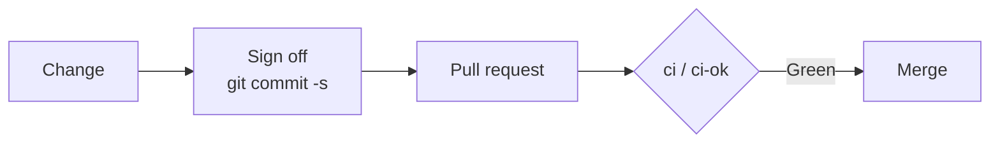

# Contributing

| Change | How |
| --- | --- |
| A figure moved | Read the vendor's own page. In a guide, update the figure with the page and today's date. A plan row is Colorado-Compute's: this repo reads and pins the catalog and never edits it. Move the pin once their row changes (see A new plan) |
| A new provider | Copy the table shape of any file in [guides/](guides/), and add a row to [guides/README.md](guides/README.md). The Guard column names the vendor's own stop at the free limit, and what removes it |
| A new plan | The catalog is [Colorado-Compute's](https://github.com/Colorado-Compute/compute-credits), and its [catalog README](https://github.com/Colorado-Compute/compute-credits/blob/main/catalog/README.md) says how a row is added. Once the row is in their `main`, move the pin here with `bash catalog/sync.sh --update <sha>` |
| A sign-in fact moved | Read the vendor's own page. Update its row in `catalog/logins.json` with the page and today's date, keys in the order of `FIELDS` in `tests/logins.test.mjs`. Never add an account, an email or a screenshot |
| Every commit | Sign off with `git commit -s` ([DCO](https://developercertificate.org/)) |
| Every pull request | `ci / ci-ok` must pass. It runs the catalog pin test, the other tests and the voice lint |
| Questions and conduct | Ask through [SUPPORT.md](SUPPORT.md). Every contributor keeps the [code of conduct](CODE_OF_CONDUCT.md) |
