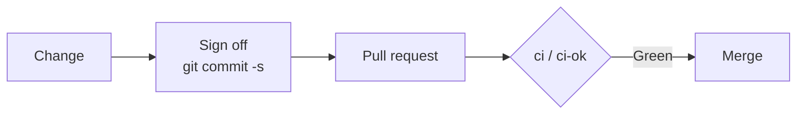

# Contributing

| Change | How |
| --- | --- |
| A figure moved | Read the vendor's own page. Update the row in compute-credits' `catalog/plans.json` (see A new plan) or the guide, with the page and today's date. Set `verified` to `true` only when you read every figure in the row there |
| A new provider | Copy the table shape of any file in [guides/](guides/), and add a row to [guides/README.md](guides/README.md). The Guard column names the vendor's own stop at the free limit, and what removes it |
| A new plan | Open a pull request in [Colorado-Compute/compute-credits](https://github.com/Colorado-Compute/compute-credits), whose [catalog README](https://github.com/Colorado-Compute/compute-credits/blob/main/catalog/README.md) lists the fields and the merge rules. Then move the pin here with `bash catalog/sync.sh --update <sha>` |
| A sign-in fact moved | Read the vendor's own page. Update its row in `catalog/logins.json` with the page and today's date, keys in the order of `FIELDS` in `tests/logins.test.mjs`. Never add an account, an email or a screenshot |
| Every commit | Sign off with `git commit -s` ([DCO](https://developercertificate.org/)) |
| Every pull request | `ci / ci-ok` must pass. It runs the catalog pin test, the other tests and the voice lint |
| Questions and conduct | Ask through [SUPPORT.md](SUPPORT.md). Every contributor keeps the [code of conduct](CODE_OF_CONDUCT.md) |
