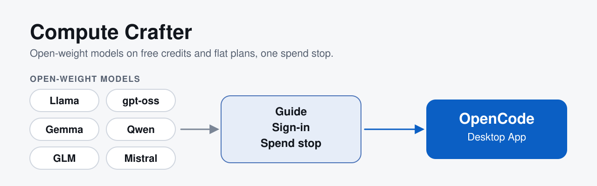

# Compute Crafter

Wire open-weight compute into the OpenCode Desktop App, on free credits and flat subscriptions. Then keep your list, sign-ins and score page. The starters work with any client. This repo promotes only open weights and OpenCode.

## [📊 Open the live score page](https://soulcraft-org.github.io/compute-crafter/)

     

## Quickstart: keep your own list

| # | Do | Where |
|---|---|---|
| 1 | Copy the compute-list starter, with its `.gitignore`, into a private repo. Keep this repo beside it, read-only | [Starter](templates/compute-list/README.md) |
| 2 | In the copy, with `gh` signed in and `jq` installed, run `bash sync.sh "$(gh release view -R SoulCraft-Org/compute-crafter --json tagName -q .tagName)" && cp mine.example.json mine.json && bash sheet.sh vendor/plans.json mine.json` | [Starter](templates/compute-list/README.md) |

The newest release tag keeps the copy still until you sync again. `bash sync.sh` alone follows main. It uses `gh api` REST only, so it runs in a Claude cloud session, where GraphQL is refused.

Replace the example rows in `mine.json` with your plans. Give each a `lane` and a `rung`, add `--ladders` to the sheet command, and use the first rung with room. A paid rung waits for your yes. Write each plan's spend guard in `notes`. [Ladders](templates/compute-list/README.md#ladders)

## Provider guides

One guide per provider, opening with a table of account, free tier, login and guard. [All guides](guides/README.md).

## Starters

Copy one folder.

| Starter | You get |
| --- | --- |
| 🗂️ [compute-list](templates/compute-list/README.md) | A sheet and board of your plans |
| 🔐 [logins](templates/logins/README.md) | A sheet and board of your sign-ins |
| 📈 [quality](templates/quality/README.md) | Your Quality, Speed and Consumption page, pinned to this pack |
| 🗺️ [process](templates/process/README.md) | The five-step Spend map on your Process page |

## Three doors

| Door | Holds |
| --- | --- |
| 🔌 [compute-crafter](https://github.com/SoulCraft-Org/compute-crafter) | This repo |
| 💳 [compute-credits](https://github.com/Colorado-Compute/compute-credits) | The plan catalog and its Credits Explorer. [catalog/](catalog/README.md) here is a pinned copy |
| 🚀 [startup-credits](https://github.com/Colorado-Startups/startup-credits) | Startup programs |

## Folder map

| Folder | Holds |
|---|---|
| `assets/` | Hero image, social preview |
| `catalog/` | Pinned plans, sign-ins |
| `collectors/` | Credits collector |
| `docs/` | Spend notes, handoffs, spec |
| `guides/` | Provider guides, checklist, CI guides |
| `ideals/` | The Credits tab's ideals |
| `maps/` | The spend map |
| `quality/` | Quality config, targets, process maps |
| `site/` | The wiring map page |
| `targets/` | The Credits tab's targets |
| `templates/` | The four starters |
| `tests/` | Pin, logins, pack tests |
| `tools/` | Lint and private-terms scan |

## Rules every page follows

| Rule | Source |
| --- | --- |
| Free credits and flat monthly plans with a lot of usage; never pay-per-use | [Compute rules](https://github.com/SoulCraft-Org/git-crafter/blob/main/rules/compute.md) |
| No key value in a session: CLI logins and OAuth first, env var names only | [Key rules](https://github.com/SoulCraft-Org/git-crafter/blob/main/rules/keys.md) |
| Every free-tier figure cites the vendor's own page and the date read | [CONTRIBUTING.md](CONTRIBUTING.md) |

## Built on

[Git Crafter](https://github.com/SoulCraft-Org/git-crafter) supplies the CI standard and Claude rules. The Credits pack (`pack.json`) moved from it ([NOTICE](NOTICE)). [pages.yml](.github/workflows/pages.yml) builds the Quality and Process pages after the [privacy gate](tests/privacy.mjs).

Published by [SoulCraft-Org](https://github.com/SoulCraft-Org) under [Apache-2.0](LICENSE).
