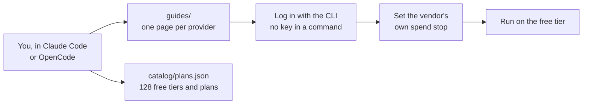

# Compute Crafter

Wire open-source and open-weight compute to Claude Code and OpenCode, on free tiers and included credits. Published by [SoulCraft-Org](https://github.com/SoulCraft-Org) under [Apache-2.0](LICENSE).

| Part | Holds |
| --- | --- |
| [guides/](guides/README.md) | One page per provider, one table shape: account, free tier with its source and date, login or key, Claude connector, OpenCode, guard |
| [guides/local-models.md](guides/local-models.md) | MLX and LM Studio serving a model on your own port |
| [catalog/](catalog/README.md) | `plans.json`, 128 plans across CI, CPU, GPU, inference, hosting and AI tools, each with its vendor page and the date read |
| [tools/catalog.py](tools/catalog.py) | The field allowlist, the merge and the self-test |
| Credits pack: `pack.json`, `targets/`, `ideals/`, `maps/`, `collectors/credits/` | Git Crafter's Credits Quality tab and Spend map, moved from Git Crafter ([NOTICE](NOTICE), [tests/moved.json](tests/moved.json)) |
| Add the pack to another repo | In its `quality/config.json`, set `"packs": ["SoulCraft-Org/compute-crafter@<40-hex sha>"]` (Git Crafter `quality/CONFIG.md`), on an engine that no longer ships the credits tab |
| [quality/config.json](quality/config.json), [quality/process/config.json](quality/process/config.json), [pages.yml](.github/workflows/pages.yml) | This repo's public Quality and Process pages, built by Git Crafter's `actions/pages` in CI mode, after the [privacy gate](tests/privacy.mjs). They show only what CI reads: the catalog's oldest read date, and the Spend map's step it scores |

## Rules every page follows

| Rule | Source |
| --- | --- |
| Free tiers and included credits only; never metered billing past an included amount | [Git Crafter compute rules](https://github.com/SoulCraft-Org/git-crafter/blob/main/rules/compute.md) |
| A session never holds a key value: CLI logins and OAuth first, env var names only | [Git Crafter key rules](https://github.com/SoulCraft-Org/git-crafter/blob/main/rules/keys.md) |
| Every free-tier figure cites the vendor's own page and the date it was read | [CONTRIBUTING.md](CONTRIBUTING.md) |

## Related

| Repo | Use |
| --- | --- |
| [SoulCraft-Org/git-crafter](https://github.com/SoulCraft-Org/git-crafter) | The CI standard this repo runs on, and the Claude Code rules and guards |
| [SoulCraft-Org/comfyui-base](https://github.com/SoulCraft-Org/comfyui-base) | The ComfyUI installer and handbook that [guides/comfyui.md](guides/comfyui.md) links |
| `Colorado-Startups/startup-credits` (not yet published) | Startup credit programs and how to apply. Accounts and keys live here; credits and applications live there |
