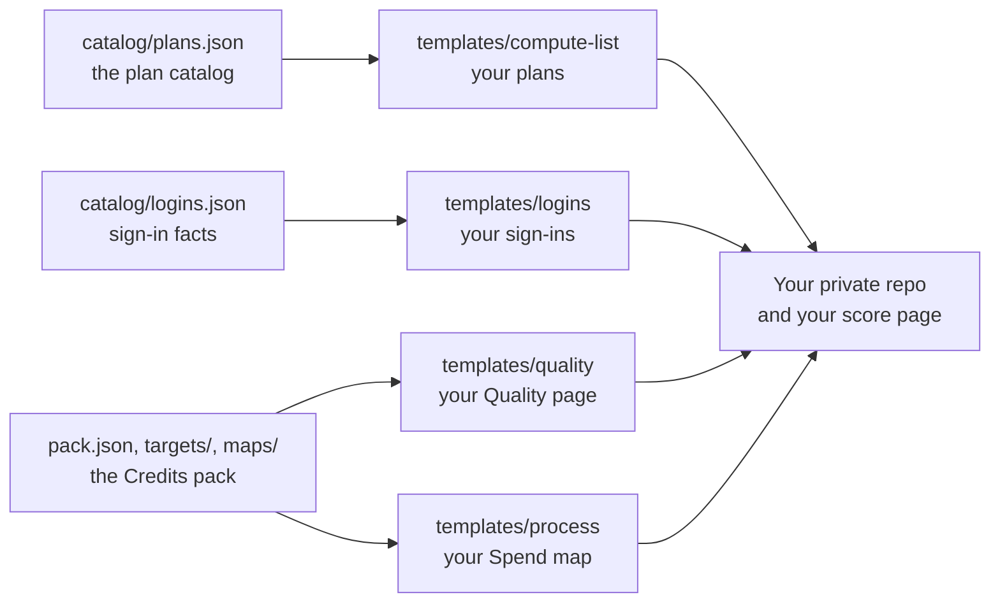

# Compute Crafter

Wire open-source and open-weight compute to Claude Code and OpenCode on free tiers and included credits, then keep your own list, sign-ins and score page. Published by [SoulCraft-Org](https://github.com/SoulCraft-Org) under [Apache-2.0](LICENSE).

**[Live score page](https://soulcraft-org.github.io/compute-crafter/)** · [Guides](guides/README.md) · [Plan catalog](catalog/README.md) · [Starters](#starters)

| Plans | Lanes | Sign-in vendors | Verified plans | Starters |
| :-: | :-: | :-: | :-: | :-: |
| **153 plans** | **6 lanes** | **44 sign-in vendors** | **150 verified** | **4 starters** |

## Starters

Copy one folder. Each has a README with its steps and a fake example you replace.

| Starter | You get | One command |
| --- | --- | --- |
| [templates/compute-list](templates/compute-list/README.md) | A sheet and a board of the plans you hold, from the plan catalog | `bash sync.sh`, then, with the two markers in your README, `bash sheet.sh vendor/plans.json mine.json --write README.md` |
| [templates/logins](templates/logins/README.md) | A sheet and a board of your sign-ins, from the sign-in catalog | `bash sync.sh`, then, with the two markers in your README, `bash sheet.sh vendor/logins.json sites.json --write README.md` |
| [templates/quality](templates/quality/README.md) | Your own Quality, Speed and Consumption page: the six Credits metrics | `node <git-crafter>/quality/collect.mjs --local --only credits` |
| [templates/process](templates/process/README.md) | The five-step Spend map on your Process page | `mkdir -p <your repo>/quality/process && cp templates/process/config.json <your repo>/quality/process/config.json` |

## What is here

| Part | Holds |
| --- | --- |
| [guides/](guides/README.md) | One page per provider, one table shape: account, free tier with its source and date, login or key, Claude connector, OpenCode, guard |
| [guides/local-models.md](guides/local-models.md) | MLX and LM Studio serving a model on your own port |
| [guides/logins.md](guides/logins.md) | One sign-in order, passkeys and codes in Apple Passwords, six lockout-safe steps per account |
| [catalog/](catalog/README.md) | `plans.json`: 153 plans across CI, CPU, GPU, inference, hosting and AI tools, each with its vendor page and the date read |
| [catalog/logins.json](catalog/logins.json) | What 44 sign-in vendors offer: methods, passkeys, 2FA, linking, email change, each with its vendor page and the date read |
| [tools/catalog.py](tools/catalog.py) | The field allowlist, the merge and the self-test |
| Credits pack: `pack.json`, `targets/`, `ideals/`, `maps/`, `collectors/credits/` | Git Crafter's Credits Quality tab and Spend map, moved from Git Crafter ([NOTICE](NOTICE), [tests/moved.json](tests/moved.json)) |
| [quality/config.json](quality/config.json), [quality/process/config.json](quality/process/config.json), [pages.yml](.github/workflows/pages.yml) | This repo's public pages, built by Git Crafter's `actions/pages` in CI mode, after the [privacy gate](tests/privacy.mjs). The Quality page shows the 11 library tabs plus Credits, and the Process page every library map plus Spend. They show only what CI reads, never a reading from a maintainer's machine |

## Add the pack to another repo

In its `quality/config.json`, set `"packs": ["SoulCraft-Org/compute-crafter@<40-hex sha>"]` (Git Crafter `quality/CONFIG.md`), on an engine that no longer ships the credits tab. The [quality starter](templates/quality/README.md) does this for you.

## Rules every page follows

| Rule | Source |
| --- | --- |
| Free tiers and included credits only; never metered billing past an included amount | [Git Crafter compute rules](https://github.com/SoulCraft-Org/git-crafter/blob/main/rules/compute.md) |
| A session never holds a key value: CLI logins and OAuth first, env var names only | [Git Crafter key rules](https://github.com/SoulCraft-Org/git-crafter/blob/main/rules/keys.md) |
| Every free-tier figure cites the vendor's own page and the date it was read | [CONTRIBUTING.md](CONTRIBUTING.md) |

## Related

| Repo | Use |
| --- | --- |
| [SoulCraft-Org/git-crafter](https://github.com/SoulCraft-Org/git-crafter) | The CI standard this repo runs on, and the Claude Code rules and guards |
| [SoulCraft-Org/comfyui-base](https://github.com/SoulCraft-Org/comfyui-base) | The ComfyUI installer and handbook that [guides/comfyui.md](guides/comfyui.md) links |
