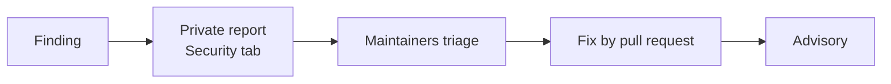

# Security

Compute Crafter is licensed under [Apache-2.0](LICENSE) and published by SoulCraft-Org. Report a security problem privately, never in a public issue.

| Step | How |
| --- | --- |
| Report | GitHub private vulnerability reporting: the repo's Security tab, **Report a vulnerability** |
| Never | open a public issue for a security problem, or paste a key value anywhere |
| Then | the fix lands by pull request, and the advisory names the reporter unless they ask otherwise |
| Conduct | A conduct problem uses the same private form: see [CODE_OF_CONDUCT.md](CODE_OF_CONDUCT.md). Other questions go through [SUPPORT.md](SUPPORT.md) |

| In scope | A finding looks like |
| --- | --- |
| A guide | A command that prints, stores or passes a key value, or a step that removes a vendor's spend stop |
| `catalog/plans.json` | A field outside the allowlist in compute-credits, an account name, or an email address |
| `catalog/logins.json` | A field outside `FIELDS`, an account name, an email address or a progress note |
| `templates/` | A starter that commits a sheet, a board input or a status file that names your accounts |
| `.github/workflows/` | A step that runs untrusted input, or an unpinned action |
