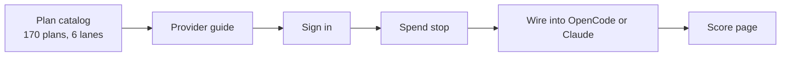

# Compute Crafter spec

| Field | Value |
|---|---|
| Status | Draft, 2026-11-25. Not adopted: it waits for the owner's answer on the open choices below |
| Repo | `SoulCraft-Org/compute-crafter`, public, Apache-2.0 |
| Written from | [README](README.md), [AGENTS.md](AGENTS.md), [GOVERNANCE](GOVERNANCE.md), [guides/](guides/README.md), [catalog/](catalog/README.md) and the open issues. No goal here is new |
| Tracks | #278 |

## Purpose

Wire open-weight compute into the OpenCode Desktop App first and the Claude Desktop App second, on free credits and flat subscriptions. Then keep your list, sign-ins and score page.

## Who it serves

| User | Gets |
|---|---|
| A person who wants open-weight models in a coding agent | One guide per provider: account, free tier, login, connector and spend guard |
| A Code Project owner | Four starters to copy: compute list, logins, Quality page, Spend map |
| A contributor | A public repo with a pinned catalog and a privacy gate |

## Goals

| Goal | Measured by |
|---|---|
| Free credits and flat plans only, never pay-per-use | Every guide opens with a spend guard. Rule: Git Crafter `rules/compute.md` |
| No key value in a session | CLI login and OAuth first, env var names only. Rule: Git Crafter `rules/keys.md` |
| Every free-tier figure cites the vendor's own page and the date read | `CONTRIBUTING.md`, `tools/voice_lint.py` |
| Nothing private ships | `tests/privacy.mjs` on every page build |
| Quality, Speed and Consumption page and Spend map at goal | The live score page |

## Non-goals

| Not | Why |
|---|---|
| Editing plan rows | They are edited in Colorado-Compute/compute-credits. `catalog/` here is a pinned copy |
| Holding anyone's account, key or balance | Vendor facts only |
| Running compute | It wires and guides |

## Parts

| Part | Folder | Done when |
|---|---|---|
| Provider guides | `guides/` | One per provider, a table first |
| Plan catalog copy | `catalog/` | `PIN` and sha256 match (`tests/catalog-pin.test.mjs`) |
| Sign-in vendors | `catalog/logins.json` | 66 vendors, vendor facts only |
| Starters | `templates/` | compute-list, logins, quality, process |
| Credits pack | `pack.json`, `collectors/`, `ideals/`, `targets/` | Tests pass beside the pinned engine |
| Spend map | `maps/`, `site/` | Five steps, each with a metric |

## Roadmap, from the open issues

| Theme | Issues |
|---|---|
| Re-read dated guide cites and re-pin the catalog after 2026-11-30 | #208, #209 |
| Pin the upstream Claudius release so the Code Project tab and Tokens metric read | #270, #274 |
| Confirm each host cell in both desktop apps | #204 |
| Quality page: unmeasured metrics, words before first action, Issues tab visuals | #231, #285, #207 |
| Code Project setup: spend guard updates and a Spend map example | #284 |

## Open choices

| # | Choice | Options | Recommendation |
|---|---|---|---|
| 1 | Order of the desktop apps | OpenCode first and Claude second, as now. Or equal | Keep the order: the README says it and the guides follow it |
| 2 | Catalog ownership | Keep the pinned copy. Or move plan rows here | Keep the copy: one source of rows avoids two catalogs |
| 3 | Re-read cadence | Every figure re-read about every 14 days (the dates now run 2026-11-12 to 2026-11-30). Or on each provider change | Every 14 days, tracked by one issue |
| 4 | Provider scope | Add a guide only when a plan has a free tier or flat price. Or list every provider | Only free or flat plans: paid-per-use stays out |
| 5 | Maintainers | Seats by GOVERNANCE (five merged PRs over three months). Or invite early | Keep GOVERNANCE as written |
