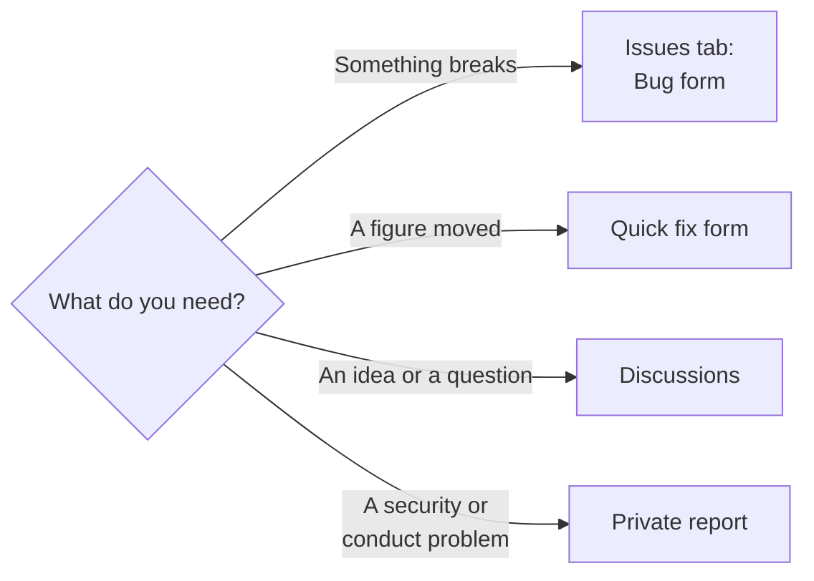

# Support

| Need | Where |
| --- | --- |
| Report a bug | The Issues tab, **New issue**, the **Bug** form |
| Report a vendor figure that moved | The **Quick fix** form, or the **Sign-in facts changed** form for a sign-in fact |
| Propose an idea | [Discussions](https://github.com/SoulCraft-Org/compute-crafter/discussions/categories/ideas), then a maintainer turns an accepted idea into an issue |
| Ask how it works | [Discussions](https://github.com/SoulCraft-Org/compute-crafter/discussions/categories/q-a), Q&A, or the [guides](guides/README.md) |
| Report a security problem | [SECURITY.md](SECURITY.md), never a public issue |
| Report conduct | [CODE_OF_CONDUCT.md](CODE_OF_CONDUCT.md) |
| Contribute a change | [CONTRIBUTING.md](CONTRIBUTING.md) |
