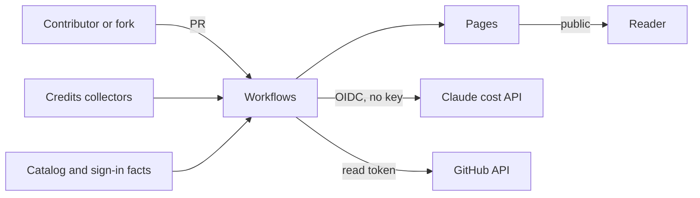

# Threat model

| Read | Covers |
|---|---|
| 2026-11-24 | Every asset below, against `main`; [Microsoft SDL](https://www.microsoft.com/en-us/securityengineering/sdl/practices) practice 3 |
| Each PR | Adds a row for a new asset, secret, write scope or hook |

## Assets

| Asset | Why it matters |
|---|---|
| Catalog data | `catalog/plans.json` is public; a private field would leak |
| Sign-in facts | `catalog/logins.json` holds vendor facts, never an account |
| Credits collectors | They read spend figures and could print a credential |
| Claude cost read | A federated bearer token reads organization cost |
| Pages | The one public surface, rebuilt on each merge |

## Threats

| Asset | Threat | Control | Gap |
|---|---|---|---|
| Catalog data | Private name or field ships | `tests/privacy.mjs`, `private-terms.yml`, a field allowlist | The private-terms list is a secret only CI sees |
| Sign-in facts | An account or email is committed | `FIELDS` check in `tests/logins.test.mjs` | None known |
| Credits collectors | Key lands in a log or page | Redaction tests; keys named by variable; gitleaks scans every push and pull request (`secret-scan.yml`) | A new collector may skip redaction |
| Claude cost read | Token theft or reuse | Workload identity federation: no stored key, a short-lived token. The Console rule pins the workflow file | A merged workflow edit can widen the claim |
| Pages | Raw reading reaches the page | Privacy gate on the run file and the build folder | A collector bug |
| Workflows | Fork code gets secrets | Read-only default token; writes on named jobs; no `pull_request_target` | Job-level writers: `wiki` (`contents: write`). `pages` deploy (`pages: write`, `id-token: write`). `scorecard` and `claude-review` (`id-token: write`). `gemini-review` (`pull-requests: write`, `id-token: write`). The rest are read-only |
| Wiki | A branch run publishes its `wiki/` | The `wiki` job runs on `main` only; the wiki is edited by PR | The wiki's own web editor, limited to collaborators |
| Workflows | Action tag moves | Full-SHA pins in `actions.lock`; 14-day cooldown | `ossf/scorecard-action` pulls its image by tag |
| `main` | Unreviewed change lands | PR rulesets, `ci / ci-ok`, DCO sign-off | One human |

Report findings: [SECURITY.md](SECURITY.md).
