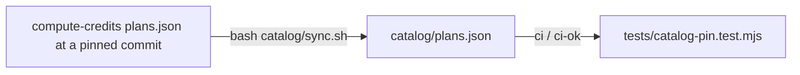

# Plan catalog

[plans.json](plans.json) lists free tiers and plans for CI, CPU, GPU, inference, hosting and AI tools. Each row names the vendor page it was read on and the date.

The catalog belongs to [Colorado-Compute/compute-credits](https://github.com/Colorado-Compute/compute-credits). `plans.json` is a checked copy that this repo reads and pins. This repo never edits it by hand. Its [catalog README](https://github.com/Colorado-Compute/compute-credits/blob/main/catalog/README.md) holds the fields, the merge rules and the tools.



| Lane | Rows | Verified | Price 0 |
| --- | --- | --- | --- |
| ci | 12 | 12 | 8 |
| cpu | 35 | 35 | 13 |
| gpu | 41 | 40 | 9 |
| inference | 36 | 33 | 15 |
| hosting | 18 | 18 | 12 |
| tools | 28 | 28 | 9 |
| **All** | **170** | **166** | **66** |

Counts are by each row's first lane, from `plans.json` as built on 2026-11-24. Rows were read between 2026-11-20 and 2026-11-24.

## Commands

[PIN](PIN) holds the commit and the sha256 of its `catalog/plans.json`. Both commands need `gh`, signed in with `gh auth login`.

```bash
bash catalog/sync.sh
```

Fetches `plans.json` at the pinned commit and refuses a hash that differs from PIN.

```bash
bash catalog/sync.sh --update <full commit sha>
```

Moves the pin to that commit, then run `node --test tests/catalog-pin.test.mjs`.
