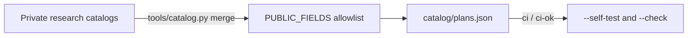

# Plan catalog

[plans.json](plans.json) lists free tiers and plans for CI, CPU, GPU, inference, hosting and AI tools. Each row names the vendor page it was read on and the date.



| Lane | Rows | Verified | Price 0 |
| --- | --- | --- | --- |
| ci | 3 | 3 | 2 |
| cpu | 29 | 6 | 7 |
| gpu | 35 | 16 | 6 |
| inference | 30 | 19 | 9 |
| hosting | 7 | 7 | 7 |
| tools | 24 | 4 | 4 |
| **All** | **128** | **55** | **35** |

Counts are by each row's first lane, from `plans.json` as built on 2026-11-12. Rows were read between 2026-10-25 and 2026-11-13.

## Fields

| Field | Holds |
| --- | --- |
| `id` | Lowercase, unique |
| `name`, `provider`, `provider_hq` | The plan, its vendor, and the vendor's home country |
| `lanes` | One or more of `ci`, `cpu`, `gpu`, `inference`, `hosting`, `tools` |
| `price_month`, `currency` | The monthly price in the currency the page states (ISO 4217), or `null` |
| `price_note`, `includes`, `resets`, `limits` | What the page says the plan gives, and when it resets |
| `unit_cost_vs_payg` | The plan's unit cost against the vendor's own pay-as-you-go rate |
| `card` | `true` when the vendor wants a card on file |
| `overage` | `stops`, `bills` or `unknown`: what happens at the limit |
| `trains_on_data`, `commercial_use` | What the terms say, or `null` when not read |
| `source`, `sources_extra` | The first-party `https://` pages read |
| `checked` | The date the row was read, `YYYY-MM-DD` |
| `verified` | `true`: every figure was read on `source` on `checked`. `false`: from older research, not re-read since. A `(3p)` mark in a `false` row means a third-party page |

`tools/catalog.py` keeps only these fields, in this order. A column a source adds never reaches this file.

## Merge

| Rule | Why |
| --- | --- |
| Rows merge by `id`; the newer `checked` wins | The newest read is the best fact |
| On a tie, the first source wins | Deterministic: the same input gives the same bytes |
| One `id` in two lanes keeps both lanes | A plan such as a Pro subscription serves two lanes |
| The winning row decides status | A plan closed since an older read stays out |
| Closed, excluded and `DROP` rows stay out | `DROP` in `tools/catalog.py` names each dropped id with its reason |

## Commands

```bash
python3 -I tools/catalog.py --self-test
```

```bash
python3 -I tools/catalog.py --check
```

```bash
python3 -I tools/catalog.py --format
```
