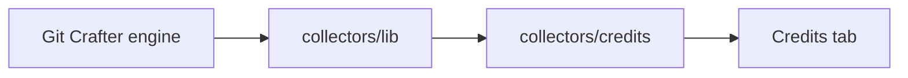

# Collectors

Code that reads data for the Credits tab of the Quality page. Each folder is one code area.

| Area | Holds | Read |
| --- | --- | --- |
| `collectors/credits/` | The Credits readers: plans, billing, provider limits and their tests | [credits.mjs](credits/credits.mjs) |
| `collectors/lib/` | `engine.mjs`, the one door to the Git Crafter engine | [engine.mjs](lib/engine.mjs) |

Run one test file at a time: `GIT_CRAFTER=<engine checkout> node --import ./tests/engine-lib.mjs --test collectors/credits/<file>.test.mjs` ([AGENTS.md](../AGENTS.md)).
