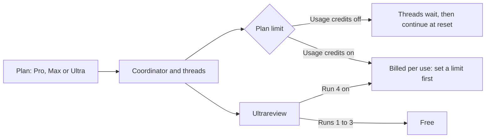

# Claude Code Projects spend guards

A Claude Code Project runs many cloud sessions on one flat plan. This page lists what draws on it and the switches that keep the bill flat.

## What draws on the plan

| Item | Draws | Source |
| --- | --- | --- |
| Running threads | Each thread is a full session, and several run at once. The enforced limit is 500 new threads a day | [Claude Code docs, Projects](https://code.claude.com/docs/en/claude-projects), read 2026-11-25 |
| The coordinator | Its own tokens, reading what threads report | [Claude Code docs, Projects](https://code.claude.com/docs/en/claude-projects), read 2026-11-25 |
| A thread watching a pull request | An idle thread wakes when CI fails or a review comment arrives | [Claude Code docs, Projects](https://code.claude.com/docs/en/claude-projects), read 2026-11-25 |
| A thread idle over an hour | The cache lasts an hour on Pro, Max and Ultra within plan limits. After that the thread re-reads its whole conversation | [Claude Code docs, Projects](https://code.claude.com/docs/en/claude-projects), read 2026-11-25 |
| The monthly API credit | Threads never spend it. They draw on the plan's usage limits. What the credit pays for: [Claude API](../guides/claude-api.md) | [Claude Code docs, Projects](https://code.claude.com/docs/en/claude-projects), read 2026-11-25; [Credits](https://support.claude.com/en/articles/17154008-monthly-api-credits-for-max-ultra-and-team-plans), read 2026-11-25 |

## Guards

| Guard | Do | Source |
| --- | --- | --- |
| Usage credits | Leave them off and keep the spend limit at zero. They bill anything past the plan limit | [Claude Code docs, costs](https://code.claude.com/docs/en/costs), read 2026-11-25 |
| Continue after a limit | Project settings, General, "Continue threads automatically when usage limits reset" is on by default. Turn it off to stop spill into the next window | [Claude Code docs, Projects](https://code.claude.com/docs/en/claude-projects), read 2026-11-25 |
| Ultrareview | Three free runs. Later runs bill as usage credits, so decline the paid prompt | [Claude Code docs, ultrareview](https://code.claude.com/docs/en/ultrareview), read 2026-11-25 |
| Model and effort | Pick a smaller model or a lower effort level for threads that do not need the largest model | [Claude Code docs, Projects](https://code.claude.com/docs/en/claude-projects), read 2026-11-25 |
| Pull request watching | Ask the thread to stop watching once the pull request merges | [Claude Code docs, Projects](https://code.claude.com/docs/en/claude-projects), read 2026-11-25 |

## Billing rule

| Spend kind | Rule |
| --- | --- |
| Monthly subscription that helps | Allowed. It is a flat fee |
| Overage or metered extra | Goal of $0: leave usage credits off, auto-reload off, and every spend limit at zero |

Anything else is one question to the owner, with a hard cap, before it is turned on.

## Plans

Pro, Max and Ultra cost $20, $100 and $200 a month, five and ten times Pro's weekly usage for Max and Ultra ([Claude pricing](https://claude.com/pricing), read 2026-11-25). The upgrade buys capacity, Fable access and API credits, not a cheaper unit. Credits and limits: [Claude API guide](../guides/claude-api.md).

## Hosts and sign-in

Hosts, plans and sign-in: [Claude Code Projects guide](../guides/claude-projects.md).
