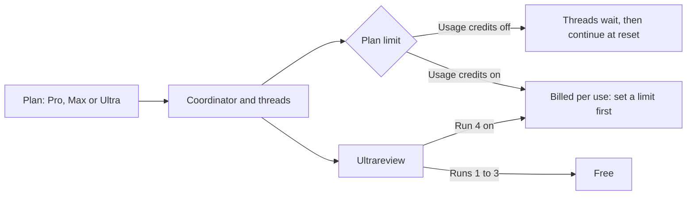

# Claude Code Projects spend guards

A Claude Code Project runs many cloud sessions on one flat plan. This page lists what draws on the plan and the switches that keep the bill flat.

## What draws on the plan

| Item | Draws | Source |
| --- | --- | --- |
| Running threads | Each thread is a full session, and several run at once. The enforced limit is 500 new threads a day | [Claude Code docs, Projects](https://code.claude.com/docs/en/claude-projects), read 2026-11-25 |
| The coordinator | Its own tokens, reading what threads report | [Claude Code docs, Projects](https://code.claude.com/docs/en/claude-projects), read 2026-11-25 |
| A thread watching a pull request | An idle thread wakes when CI fails or a review comment arrives | [Claude Code docs, Projects](https://code.claude.com/docs/en/claude-projects), read 2026-11-25 |
| A thread idle over an hour | The cache lasts an hour on Pro, Max and Ultra within plan limits. After that the thread re-reads its whole conversation | [Claude Code docs, Projects](https://code.claude.com/docs/en/claude-projects), read 2026-11-25 |

## Guards

| Guard | Do | Source |
| --- | --- | --- |
| Usage credits | Leave them off, or set a monthly spend limit before turning them on. They bill anything past the plan limit | [Claude Code docs, costs](https://code.claude.com/docs/en/costs), read 2026-11-25 |
| Continue after a limit | Project settings, General, "Continue threads automatically when usage limits reset" is on by default. Turn it off to stop work from spilling into the next window | [Claude Code docs, Projects](https://code.claude.com/docs/en/claude-projects), read 2026-11-25 |
| Ultrareview | Three free runs on Pro, Max and Ultra. Later runs bill as usage credits, so decline the paid prompt | [Claude Code docs, ultrareview](https://code.claude.com/docs/en/ultrareview), read 2026-11-25 |
| Model and effort | Pick a smaller model or a lower effort level for threads that do not need the largest model | [Claude Code docs, Projects](https://code.claude.com/docs/en/claude-projects), read 2026-11-25 |
| Pull request watching | Ask the thread to stop watching once the pull request merges | [Claude Code docs, Projects](https://code.claude.com/docs/en/claude-projects), read 2026-11-25 |
| New work | Start a fresh thread instead of reviving a large old one | [Claude Code docs, Projects](https://code.claude.com/docs/en/claude-projects), read 2026-11-25 |

## The monthly API credit

Max and Ultra plans include a monthly API credit once a Console organization is linked. It does not pay for Projects.

| Surface | Draws on | Source |
| --- | --- | --- |
| Claude API, Console Playground, Managed Agents | The monthly API credit | [Credits](https://support.claude.com/en/articles/17154008-monthly-api-credits-for-max-ultra-and-team-plans), read 2026-11-25 |
| Agent SDK, and `claude -p` run with an API key from the linked organization | The monthly API credit | Same page |
| Projects threads, interactive Claude Code, the Desktop app, an IDE extension, the Claude Code GitHub Action | Plan usage limits. The credit does not cover them | Same page |

Max gets $100 a month and Ultra $200, with no rollover. Claim it after seven days on the plan ([Credits](https://support.claude.com/en/articles/17154008-monthly-api-credits-for-max-ultra-and-team-plans), read 2026-11-25). API use stops at the credit only when you hold and buy no extra credit. Keyless CI with the Agent SDK: [Claude API CI](../guides/detail/claude-api-ci.md).

## Plans

The Claude pricing page lists Pro at $20 a month, or $17 a month billed yearly, Max at $100 and Ultra at $200 ([Claude pricing](https://claude.com/pricing), read 2026-11-25). It gives Max five times and Ultra ten times Pro's weekly usage, so every tier costs $20 per Pro-sized unit. The upgrade buys capacity, Fable access and API credits, not a cheaper unit. The credits and their limits are in the [Claude API guide](../guides/claude-api.md).

## Hosts

| Host | Projects | Source |
| --- | --- | --- |
| OpenCode Desktop App | ➖ Not available. Threads run with Anthropic as the model provider | [Claude Code docs, Projects](https://code.claude.com/docs/en/claude-projects), read 2026-11-25 |
| Claude Desktop App, Code tab | ✅ Projects are in the Code tab of the desktop app and at claude.ai/code | [Claude Code docs, Projects](https://code.claude.com/docs/en/claude-projects), read 2026-11-25 |
| Claude Desktop App, Cowork | ❔ Not confirmed. The page names the Code tab, the website and the mobile app | [Claude Code docs, Projects](https://code.claude.com/docs/en/claude-projects), read 2026-11-25 |

Projects are a beta on Pro, Max and Ultra. They are not offered on Team or Enterprise plans yet ([Claude Code docs, Projects](https://code.claude.com/docs/en/claude-projects), read 2026-11-25).
