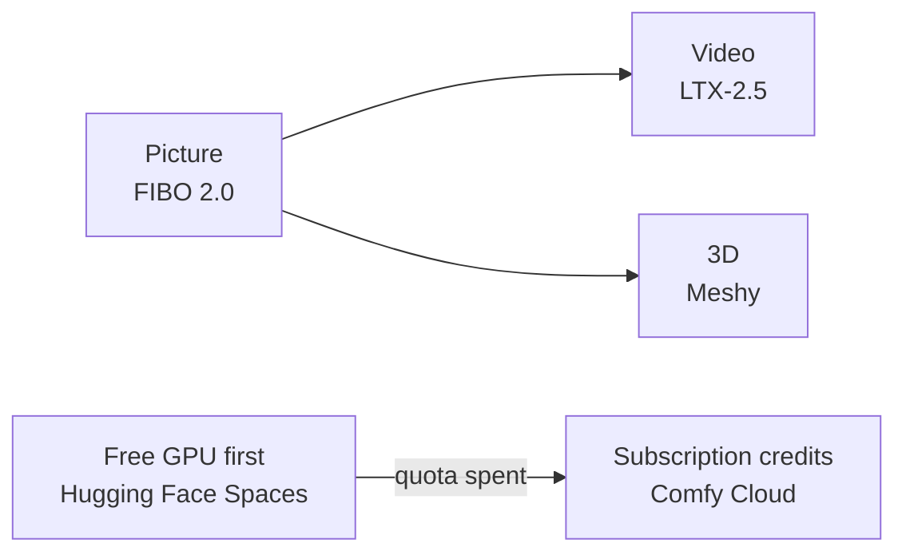

# From the site-building session, 2026-11-24: three lanes worth a guide

A session building a website used three compute lanes on 2026-11-24. The Meshy guide landed (#157). These are the
facts it measured, for the guides on the [Compute Crafter board](https://github.com/orgs/SoulCraft-Org/projects/3).

| Lane | What was measured | Source |
|---|---|---|
| Comfy Cloud, open-weight template `video_ltx2_5_i2v` | a 5 s, 1280×704 clip took 18 to 36 GPU-seconds on an RTX PRO 6000. It used 5 to 10 credits | its billing activity feed, 2026-11-24 |
| Comfy Cloud, Bria FIBO 2.0 API node | about 12 credits an image | the spend prompt and the feed |
| Comfy Cloud, spend gate | a paid API node asks for a yes first. A standing rule counts only when the user said it in that same conversation, so a subagent cannot confirm a spend | the tool's own reply |
| Comfy Cloud, balance | the activity feed shows each job's credits but no balance | the feed |
| Comfy Cloud, Bria text to image | sending both `prompt` and `structured_prompt` failed twice with "semantic errors"; plain `prompt` alone worked. The feed showed no charge for the two failures | two failed jobs, 2026-11-24 |
| Hugging Face ZeroGPU | when the daily quota is spent the Space answers that the ZeroGPU quota is exceeded, with a wait of about 9 hours, and offers paid minutes. Paid minutes are per-use billing | the Space's error text |
| Meshy | image to 3D: hero model 30 credits, game model 15, rig with a walk clip 5 | each task's `consumed_credits` |
| Meshy | a hero GLB arrives at 67 to 145 MB; `gltf-transform optimize` brings it to 1.5 to 3.2 MB | file sizes, 2026-11-24 |
| Meshy | it rigs two-legged and four-legged bodies only, and forcing an A-pose drops a prop held in the hand | docs.meshy.ai `api/rigging-and-animation`; one run |

## Next (cards on the board)

| Guide | Covers |
|---|---|
| Comfy Cloud lane | subscription credits, open-weight templates before API nodes, the spend gate, reading the feed before and after |
| Hugging Face free GPU | the daily quota, what the error looks like, why top-ups are out under a no-per-use rule |
| Fish Audio Drama 3 lane | where an open-weight voice model runs for free |
