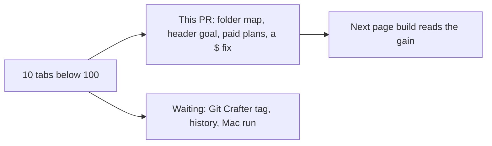

# Compute Crafter to 100: what moved and what is owed (2026-11-25)

Read from the [live page](https://soulcraft-org.github.io/compute-crafter/) at 2026-11-25 18:27 UTC: master 95, Quality 90, Speed 95. Ten measured tabs sat below 100 and five read not measured.

## Measured tabs

| Tab | Miss | State |
|---|---|---|
| Docs | Folders with a map row, per the live page 84.6% | Fixed here: two Folder map rows |
| Pages | Header goal, 1 of 4 | Fixed here: goal is the 1 of 4 the host sends (#252) |
| Pages | Long sentence, words before action | Fixed in Git Crafter #543, untagged. Pin the next tag (#156) |
| Issues | Open bugs, bugs closed by PR | #226 fixed here. #234 is the owner's. #202 waits on Claudius. The rest is history |
| Issues | Cards with a visual, per the live page 50% | Five closed issues gained a diagram. Each new issue carries one |
| PRs | Green at head, linking an issue | History: 20 merges roll the window. This PR links an issue |
| Security | Claude review share | PR #246 drops it |
| Actions | Failed run share | `claude-review` was the failing workflow. PR #246 removes it |
| Projects | Cards at a glance, per the live page 0% | Owed: a picture on each open card needs a board write token |
| Code | Lines change, per the live page 1.4% over | This PR adds 16 code lines, so it reads near until net-negative PRs land |
| Blockers | Pushes per merged PR, 2.5 | One push per PR |
| Visibility | Personal emails | Stays by the owner's 2026-11-24 decision |

## Not measured

Claude, Desktop, Tokens and Instructions read `~/.claude` on the owner's Mac. A local run keeps its numbers off the public page by design (`tests/privacy.mjs`), so only the Mac build shows them. Credits quality is local too, and gains `credits.paid_plans_in_use`. A run in a cloud session read 4 of the 38 metrics those collectors hold, because the transcripts belong to the Mac.

## Owed

| Do | Where |
|---|---|
| Run `node <git-crafter>/quality/collect.mjs --local` on the Mac, then build the page there | #231 |
| Re-read 14 figures that carry no read date in 8 guides, with the vendor's page open | #208 |
| Pin the Git Crafter tag that holds #543 | #156 |
