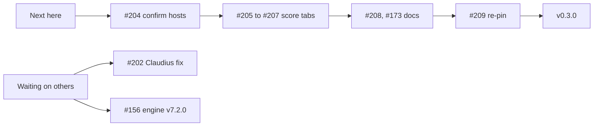

# Pick-up plan, 2026-11-25

State at the end of the 2026-11-24 session. Open work is on the [Compute Crafter board](https://github.com/orgs/SoulCraft-Org/projects/3) and in [issues](https://github.com/SoulCraft-Org/compute-crafter/issues).

## Where things stand

| Thing | State |
| --- | --- |
| Live page | 94 of 100 per the [live page](https://soulcraft-org.github.io/compute-crafter/), read 2026-11-24 20:55 UTC: Quality 88, Speed 92, Consumption 100 |
| Guides | All 21 open with a diagram and a three-host Wiring table (#192) |
| Wiring map | Three hosts, live at [map.html](https://soulcraft-org.github.io/compute-crafter/map.html) (#201). A test keeps its marks equal to `guides/README.md` |
| Catalog | Lives in Colorado-Compute/compute-credits. This repo keeps a checked copy at `catalog/PIN` |
| Engine | Git Crafter v7.1.0. Claudius pack v1.2.0, with `lead_time.hours` dropped in `quality/targets/claude.json` (#203) |
| Tracking | Every issue and merged PR is on the board |

## Next

| # | Do | Done when |
| --- | --- | --- |
| 1 | #204: try each ❔ route in both desktop apps | no ❔ is left that a five-minute try settles |
| 2 | #205, #206, #207: the Docs, Code and Issues tab misses | each tab at goal on the live page |
| 3 | #208: re-read guide cites older than 2026-11-24. #173: describe the `claude_cost` reader | merged |
| 4 | #209: re-pin the catalog after the 2026-11-30 re-read (compute-credits #20) | `catalog/PIN` names the new commit |
| 5 | Release v0.3.0 after the first user's page reads real numbers (board card) | tagged |

## Waiting on others

| Issue | Waits on | Then |
| --- | --- | --- |
| #202 | Colorado-Startups/claudius#116 merged and released | run the `bump-pins` skill, delete `quality/targets/claude.json` |
| #156 | git-crafter #360 tags v7.2.0 | pin it |

## Decided by the owner, 2026-11-24

| Decision | Detail |
| --- | --- |
| Two hosts | The OpenCode Desktop App first, then the Claude Desktop App (Code and Cowork). The Claude Code CLI is never a route. CLI tools that plug in are fine |
| Visual first | Docs, guides, plans and repos lead with a visual. Words only where a visual cannot carry it |
| Money | Free credits and high-value flat subscriptions: yes. Pay per token: never ([Git Crafter compute rules](https://github.com/SoulCraft-Org/git-crafter/blob/main/rules/compute.md)) |
| Speed | It is one of three pillars. Go faster wherever build quality holds |
| History | Old author emails stay. Main is never force-pushed, and the miss stays visible |

## Traps

| Trap | Do |
| --- | --- |
| The repo's hourly Actions API allowance runs out | Build at most two PRs at once, with one push each |
| Default-setup CodeQL cannot be retried | A new signed commit restarts it. A reopen does not |
| Pushes per merged PR read 3.1 against a goal of 2 | It recovers as one-push PRs merge |
| Workers drop facts when they trim | Put the review checklist in the brief. Check the diff against the claims ledger |

Start a session in this folder with: "Read `docs/handoff/2026-11-25-next.md` and work the Next table top down."
