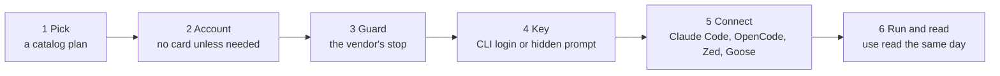

# Provider checklist

Copy this file once per provider, fill the blanks, and keep it beside your own notes. Each step must be done before the next starts.

## Symbols

| Symbol | Meaning |
| --- | --- |
| ⬜ | To do |
| ✅ | Done and checked |
| ⛔ | Blocked: write what blocks it |
| ➖ | Does not apply to this provider |

## Names

Fill these from [Names](README.md#names).

| Name | Value |
| --- | --- |
| Vendor | `<vendor>` |
| Plan id | `<vendor>-<plan>` |
| Consumer | `<consumer>` |
| Stored key | `<vendor>:<consumer>` |
| Variable | `<CONSUMER>_<VENDOR>_API_KEY`, or the name the tool fixes |
| Vendor page | `<url>`, read `<YYYY-MM-DD>` |

## Steps

| # | Step | Done when | Status |
| --- | --- | --- | --- |
| 1 | Pick | The plan's row in [plans.json](../catalog/plans.json) matches its vendor page, read today. A changed figure goes in a pull request ([CONTRIBUTING.md](../CONTRIBUTING.md)) | ⬜ |
| 2 | Account | You signed up with the vendor's own sign-in. A card is on file only if the plan's `card` field is `true` | ⬜ |
| 3 | Guard | The vendor's own stop is on before the first call, and you wrote down what removes it. An alert alone is not a stop | ⬜ |
| 4 | Key | A CLI login or OAuth holds the credential. Without one, each consumer has its own key under its stored key name. You typed it only at a hidden prompt | ⬜ |
| 5 | Connect | The tool reads the credential from its own store or from the variable at launch. No key is in a config file, a dotfile or shell history | ⬜ |
| 6 | Run and read | The first call ran on the free tier. You read its use on the vendor's usage page that day | ⬜ |
