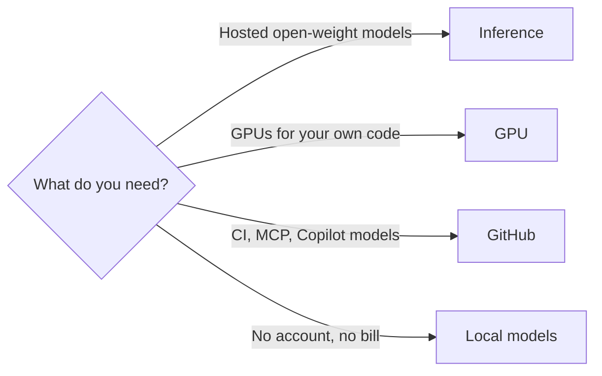

# Provider guides

One page per provider. Each page opens with one table: account, free tier with its source and date, login or key, Claude connector, OpenCode, guard.

| Guide | Lane | What it covers |
| --- | --- | --- |
| [Hugging Face](hugging-face.md) | Inference, GPU | Hub models, ZeroGPU Spaces, Inference Providers, the Hugging Face MCP server |
| [NVIDIA](nvidia.md) | Inference | NIM trial endpoints on build.nvidia.com, NGC containers, the CUDA docs MCP server |
| [Groq](groq.md) | Inference | Fast hosted open-weight models on a free plan |
| [OpenRouter](openrouter.md) | Inference | One OpenAI-compatible API over many vendors, with `:free` variants |
| [Together AI](together.md) | Inference | Prepaid per-token open-weight models |
| [Cloudflare Workers AI](cloudflare-workers-ai.md) | Inference | A free daily Neurons allocation and hosted MCP servers |
| [Ollama](ollama.md) | Inference | Cloud models paid from usage credits on a $0 plan, and launchers for Claude Code and OpenCode |
| [Modal](modal.md) | GPU | Serverless GPUs for your own code, and Shared Endpoints |
| [RunPod](runpod.md) | GPU | Prepaid GPU pods and Serverless endpoints, the RunPod MCP server |
| [AMD](amd.md) | GPU | ROCm, and one-time AMD Developer Cloud credit |
| [ComfyUI](comfyui.md) | GPU | Comfy Cloud, comfy-cli, and the [comfyui-base](https://github.com/SoulCraft-Org/comfyui-base) installer |
| [Claude Desktop MCP](claude-desktop-mcp.md) | Client | One MCP server for the Code tab and Cowork: a custom connector, or a desktop extension that bridges a loopback app |
| [GitHub](github.md) | CI, tools | Actions, `gh` login, the GitHub MCP server, the App manifest flow, Copilot in OpenCode |
| [Local models](local-models.md) | Local | MLX and LM Studio serving a model on your own port |
| [Logins](logins.md) | Accounts | One sign-in order, passkeys and codes in Apple Passwords, the logins catalog and starter |
| [Training](training.md) | GPU | LoRA, then RL such as GRPO, on free and subscription credits: jobs by GPU size, lanes with their terms and card guards, lanes to avoid |
| [Zed](zed.md) | Client | An editor that runs open-weight models on your own keys, and Claude Code, OpenCode and Goose over ACP |
| [Goose](goose.md) | Client | An open-source agent, CLI and desktop app, that keeps provider keys in the system keyring |

Every free-tier figure is on its guide page, with the vendor's own page and the date it was read. [catalog/plans.json](../catalog/plans.json) holds the plans across all vendors.

## OpenCode 2

Every guide's OpenCode step follows these rules, read on OpenCode's own pages on 2026-11-20 and checked against `opencode` v2.3.2.

| Topic | Rule | Source |
| --- | --- | --- |
| Key store | `opencode auth login` saves an API key or OAuth token as an account in the server's SQLite database, usually `~/.local/share/opencode/opencode.db`. OpenCode 2 imports a legacy `auth.json` once and never writes that file again | [CLI providers](https://opencode.ai/docs/cli/providers) |
| Key entry | `opencode auth login <provider> --method key` asks for the key at a hidden prompt, in an interactive terminal. Method IDs are provider-specific: drop `--method` to pick from a list | [CLI providers](https://opencode.ai/docs/cli/providers) |
| Never `--answer` | `--answer key=value` fills a provider form from the command line, so a key there lands in shell history and the process list | `opencode auth login --help` |
| Background service | OpenCode starts one shared server per user, and every client uses it, `opencode run` included. A variable reaches only the server process, so a key in your shell is invisible to the shared service | [CLI](https://opencode.ai/docs/cli), [CLI providers](https://opencode.ai/docs/cli/providers) |
| Keys from the environment | Start a private server from the shell that holds the variable: `opencode --standalone`. Never give a key to `opencode service set env NAME value`: it takes the value as an argument. A value that is not a secret, such as an account ID, is fine there | [CLI providers](https://opencode.ai/docs/cli/providers) |
| `{env:VAR}` | A config value `"{env:VAR}"` reads a variable; an unset one becomes an empty string. The server owns configuration, so pair a variable with `--standalone` | [Config](https://opencode.ai/docs/config), [CLI](https://opencode.ai/docs/cli) |
| Updates | Set `"update": "disable"` in the global config when a package manager owns the install. The default, `"notify"`, shows each update before installing it. Project-level values are ignored | [Config](https://opencode.ai/docs/config) |
| `auth export` | `opencode auth export` prints every stored credential, secrets included, as JSON. Never run it where a log or a screen share can read it | `opencode auth --help` |
| Config shape | V2 lists providers under `providers`, with `package` and `settings`, and MCP servers under `mcp.servers`. V1's `provider`, `npm` and `options` still load | [Migrate from V1](https://opencode.ai/docs/migrate-v1) |

## Rules every guide follows

| Rule | Source |
| --- | --- |
| Free tiers and included credits only | [Git Crafter compute rules](https://github.com/SoulCraft-Org/git-crafter/blob/main/rules/compute.md) |
| A CLI login or OAuth first; an env var name, never a key value | [Git Crafter key rules](https://github.com/SoulCraft-Org/git-crafter/blob/main/rules/keys.md) |
| The Guard column names the vendor's own stop at the free limit, and what removes it | [CONTRIBUTING.md](../CONTRIBUTING.md) |

## Names

Three parts name every plan, stored key and variable: the vendor, the plan and the consumer. [CHECKLIST.md](CHECKLIST.md) uses them for each new provider.

| Name | Pattern | Example | Rule |
| --- | --- | --- | --- |
| Vendor | A lowercase slug | `groq` | The prefix of the vendor's plan ids in the catalog |
| Plan id | `<vendor>-<plan>` | `groq-free` | The catalog's `id` field ([catalog/README.md](../catalog/README.md)) |
| Consumer | A lowercase slug for the tool or job that uses the key | `ci`, `nightly-eval` | One key per consumer, so revoking one leaves the others working |
| Stored key | `<vendor>:<consumer>` | `groq:ci` | The name in your secret store. The value never appears in a file, a command or a log |
| Variable | `<CONSUMER>_<VENDOR>_API_KEY`, upper case, `-` as `_` | `CI_GROQ_API_KEY`, `NIGHTLY_EVAL_GROQ_API_KEY` | Load it from the stored key at launch, never from a dotfile |
| Fixed variable | The tool's own name | `GROQ_API_KEY` in OpenCode's catalog ([models.dev](https://models.dev), read 2026-11-20) | Some tools fix the name. Load the stored key into it for one process only |
