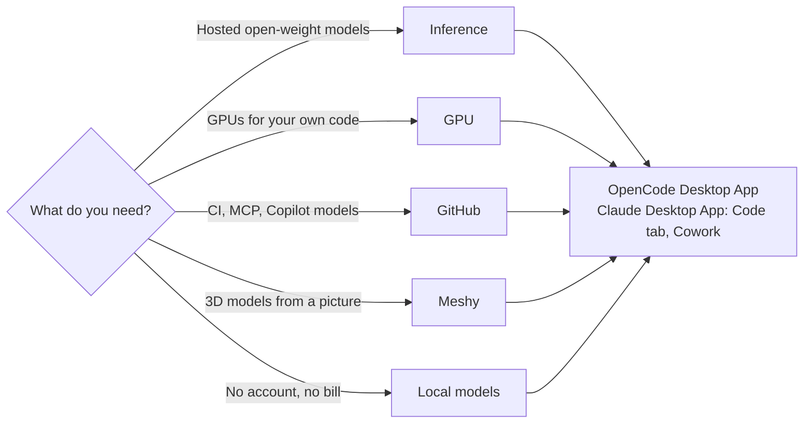

# Provider guides

One page per provider. Each has one table: account, free tier, login or key, Claude connector, OpenCode, guard. The pilot pages add a diagram and a wiring table. Four topic pages open with their own table or text: [Local models](local-models.md), [Logins](logins.md), [Training](training.md) and [Claude Desktop MCP](claude-desktop-mcp.md).

| Guide | Lane | OpenCode Desktop App | Code tab | Cowork | Covers |
| --- | --- | --- | --- | --- | --- |
| [Ollama](ollama.md) | 🧠 Inference | ✅ | ⬜ | ✅ | Cloud models on usage credits |
| [OpenRouter](openrouter.md) | 🧠 Inference | ✅ | ✅ | ✅ | One API, many vendors, `:free` variants |
| [Hugging Face](hugging-face.md) | 🧠 Inference, ⚡ GPU | ✅ | ✅ | ✅ | Hub models, ZeroGPU Spaces, Inference Providers, MCP server |
| [NVIDIA](nvidia.md) | 🧠 Inference | ⬜ | ⬜ | ⬜ | NIM trial endpoints, NGC containers, CUDA docs MCP server |
| [Groq](groq.md) | 🧠 Inference | ⬜ | ⬜ | ⬜ | Fast open-weight models on a free plan |
| [Together AI](together.md) | 🧠 Inference | ⬜ | ⬜ | ⬜ | Prepaid per-token open-weight models |
| [Cloudflare Workers AI](cloudflare-workers-ai.md) | 🧠 Inference | ⬜ | ⬜ | ⬜ | Free daily Neurons, hosted MCP servers |
| [Claude API](claude-api.md) | 🧠 Inference | ⬜ | ⬜ | ⬜ | API credits in Max, Ultra and Team plans, keyless CI |
| [Modal](modal.md) | ⚡ GPU | ⬜ | ⬜ | ⬜ | Serverless GPUs, Shared Endpoints |
| [RunPod](runpod.md) | ⚡ GPU | ⬜ | ⬜ | ⬜ | Prepaid pods and Serverless endpoints, RunPod MCP server |
| [AMD](amd.md) | ⚡ GPU | ⬜ | ⬜ | ⬜ | ROCm, one-time AMD Developer Cloud credit |
| [Google Cloud](google-cloud.md) | 🖥️ CPU, ⚡ GPU | ⬜ | ⬜ | ⬜ | The $300 Free Trial, budget kill switch, quotas |
| [ComfyUI](comfyui.md) | ⚡ GPU | ⬜ | ⬜ | ⬜ | Comfy Cloud, comfy-cli, [comfyui-base](https://github.com/SoulCraft-Org/comfyui-base) installer |
| [Training](training.md) | ⚡ GPU | ⬜ | ⬜ | ⬜ | LoRA, then RL such as GRPO, on free credits |
| [Meshy](meshy.md) | 🧊 3D | ⬜ | ⬜ | ⬜ | Picture or prompt to rigged 3D model, CLI, skills, MCP server |
| [GitHub](github.md) | 🔧 CI, tools | ⬜ | ⬜ | ⬜ | Actions, `gh` login, MCP server, App manifest, Copilot in OpenCode |
| [Claude Desktop MCP](claude-desktop-mcp.md) | 🔌 Client | ➖ | ✅ | ✅ | One MCP server for Code tab and Cowork |
| [Zed](zed.md) | 🔌 Client | ⬜ | ⬜ | ⬜ | Editor on your keys, agents over ACP |
| [Goose](goose.md) | 🔌 Client | ⬜ | ⬜ | ⬜ | Open-source agent, keys in the keyring |
| [Local models](local-models.md) | 🏠 Local | ⬜ | ⬜ | ⬜ | MLX and LM Studio on your own port |
| [Logins](logins.md) | 🔑 Accounts | ⬜ | ⬜ | ⬜ | One sign-in order, passkeys, logins catalog |

✅ wired, ⬜ not yet confirmed (issue #192), ➖ not available. The three provider rows were read 2026-11-24, the Claude Desktop MCP row 2026-11-20.

Every free-tier figure cites the vendor's page and read date. [catalog/plans.json](../catalog/plans.json) holds every plan.

## OpenCode 2

Key store, hidden prompt, `--standalone`, update and `{env:VAR}` rules: [OpenCode 2 rules](reference/opencode-2.md).

## Rules every guide follows

| Rule | Source |
| --- | --- |
| Free tiers and included credits only | [Git Crafter compute rules](https://github.com/SoulCraft-Org/git-crafter/blob/main/rules/compute.md) |
| A CLI login or OAuth first; an env var name, never a key value | [Git Crafter key rules](https://github.com/SoulCraft-Org/git-crafter/blob/main/rules/keys.md) |
| Guard names the vendor's own stop at the free limit and what removes it | [CONTRIBUTING.md](../CONTRIBUTING.md) |

## Names

Vendor, plan and consumer name every plan, key and variable: [Names](reference/names.md).
