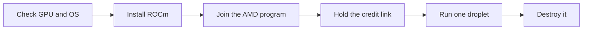

# AMD

AMD gives a Claude Code or OpenCode user ROCm, its open-source GPU stack for running open-weight models on AMD GPUs, and one-time AMD Developer Cloud credit on Instinct MI300X.

| Account | Free tier | Login or key | Claude connector | OpenCode | Guard |
| --- | --- | --- | --- | --- | --- |
| An AMD AI Developer Program member, which is "free to join" ([AMD AI Developer Program](https://www.amd.com/en/developer/ai-dev-program.html), read 2026-11-12). The credit targets "independent developers and open-source project contributors", and AMD awards it on your stated use case ([AMD Developer Cloud](https://www.amd.com/en/developer/resources/cloud-access/amd-developer-cloud.html), read 2026-11-12). | A $100 complimentary credit, expiring 30 days from deposit unless your confirmation email says otherwise ([AMD Developer Cloud](https://www.amd.com/en/developer/resources/cloud-access/amd-developer-cloud.html), read 2026-11-12). One use per account ([DigitalOcean AMD credits](https://docs.digitalocean.com/products/amd/details/credits/), read 2026-11-12). A 1x MI300X costs $2.59 an hour, so $100 covers about 38 hours ([DigitalOcean AMD pricing](https://docs.digitalocean.com/products/amd/details/pricing/), read 2026-11-12). ROCm itself is open source ([ROCm documentation](https://rocm.docs.amd.com/en/latest/), read 2026-11-12). | Browser sign-in to the AMD Developer Cloud console. ROCm needs no key. | None. | None for ROCm. A model you serve on the droplet with an OpenAI-compatible server is a custom provider ([OpenCode providers](https://opencode.ai/docs/providers), read 2026-11-12). | With no payment method on file, the VM and its data are destroyed when the credit expires or runs out ([AMD Developer Cloud](https://www.amd.com/en/developer/resources/cloud-access/amd-developer-cloud.html), read 2026-11-12). Adding a payment method removes the stop: AMD then charges it "once credit is exhausted". See [Git Crafter compute rules](https://github.com/SoulCraft-Org/git-crafter/blob/main/rules/compute.md). |

## Set up

1. Check your GPU and OS in the [ROCm compatibility matrix](https://rocm.docs.amd.com/en/latest/compatibility/compatibility-matrix.html). ROCm 10.1.0 lists Linux distributions and Windows, and no macOS ([compatibility matrix](https://rocm.docs.amd.com/en/latest/compatibility/compatibility-matrix.html), read 2026-11-12).

2. Install ROCm from the [ROCm Core SDK install page](https://rocm.docs.amd.com/en/latest/install/rocm.html). It offers a package manager, `amdgpu-install` (Radeon and Ryzen), pip wheels, a tarball and a runfile. If unsure, AMD points you to the package manager on Linux or the tarball on Windows.

3. For cloud MI300X time, join the [AMD AI Developer Program](https://www.amd.com/en/developer/ai-dev-program.html). Then apply on the [AMD Developer Cloud](https://www.amd.com/en/developer/resources/cloud-access/amd-developer-cloud.html) page with your use case.

4. Hold the emailed credit link until your job is ready. Approved credit lands within 3 business days, and opening the link activates it ([AMD Developer Cloud](https://www.amd.com/en/developer/resources/cloud-access/amd-developer-cloud.html), read 2026-11-12). The 30-day clock starts at deposit ([AMD Developer Cloud](https://www.amd.com/en/developer/resources/cloud-access/amd-developer-cloud.html), read 2026-11-12).

5. Create one MI300X GPU droplet, run the job, and copy results off the VM.

6. Destroy the droplet in the console as soon as the job ends. Powering it off does not stop the meter.

Traps and sources: [AMD traps and sources](detail/amd.md).
