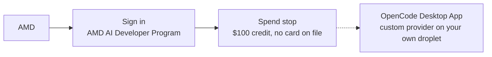

# AMD

AMD gives ROCm, its open-source GPU stack for open-weight models, and a one-time AMD Developer Cloud credit on Instinct MI300X. It names no connector for the OpenCode Desktop App.

| Account | Free tier | Login or key | OpenCode | Guard |
| --- | --- | --- | --- | --- |
| An AMD AI Developer Program member, which is "free to join" ([Program](https://www.amd.com/en/developer/ai-dev-program.html), read 2026-11-24). Credit goes to "independent developers and open-source project contributors" on your use case ([AMD Developer Cloud](https://www.amd.com/en/developer/resources/cloud-access/amd-developer-cloud.html), read 2026-11-24). | $100 credit, expiring 30 days after deposit unless your email says otherwise ([AMD Developer Cloud](https://www.amd.com/en/developer/resources/cloud-access/amd-developer-cloud.html), read 2026-11-24). One use per account ([DigitalOcean AMD credits](https://docs.digitalocean.com/products/amd/details/credits/), read 2026-11-24). | AMD sign-on to the Developer Cloud console. ROCm needs no key. | None for ROCm. A model you serve yourself is a custom provider ([OpenCode providers](https://opencode.ai/docs/providers), read 2026-11-24). | With no card, the VM and its data are destroyed at expiry. A card removes the stop. [Guard detail](detail/amd.md#guard). See [Git Crafter compute rules](https://github.com/SoulCraft-Org/git-crafter/blob/main/rules/compute.md). |

## Wiring

| Host | Plugs in as | Source, read 2026-11-24 |
| --- | --- | --- |
| OpenCode Desktop App | Not confirmed. AMD's page names no OpenCode step. A model you serve on the droplet with an OpenAI-compatible server fits a custom provider. | [AMD Developer Cloud](https://www.amd.com/en/developer/resources/cloud-access/amd-developer-cloud.html), [OpenCode providers](https://opencode.ai/docs/providers) |

Commands

AMD publishes no command for this guide. The install page lists a package manager, `amdgpu-install`, pip wheels, a tarball and a runfile ([ROCm install](https://rocm.docs.amd.com/en/latest/install/rocm.html), read 2026-11-12).

Guard and set up: [AMD detail](detail/amd.md). Traps and sources: [AMD traps and sources](detail/amd-traps.md).
