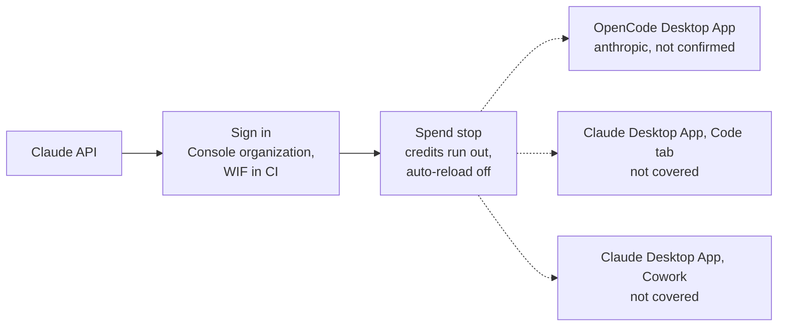

# Claude API

Max, Ultra and Team plans include monthly Claude API credits. GitHub Actions can call the API with no stored key through workload identity federation (WIF). The credits do not pay for the Desktop App.



| Account | Free tier | Login or key | Claude connector | OpenCode | Guard |
| --- | --- | --- | --- | --- | --- |
| A Claude Console organization, linked to a Max, Ultra or Team plan. No Claude Platform payment method ([API credits](https://platform.claude.com/docs/en/about-claude/api-credits-for-subscribers), read 2026-11-24). | Per the credits page, a month brings $100 on Max and $200 on Ultra. Team gets $20 per Standard seat and $100 per Premium, pooled to $500 ([API credits](https://platform.claude.com/docs/en/about-claude/api-credits-for-subscribers), read 2026-11-24). | CI: federation, no key. Otherwise one service account key per consumer in `ANTHROPIC_API_KEY`. | None. The credits exclude Claude Code and extra usage in the Claude apps ([API credits](https://platform.claude.com/docs/en/about-claude/api-credits-for-subscribers), read 2026-11-24). | `anthropic`, env `ANTHROPIC_API_KEY` ([models.dev](https://models.dev/api.json), read 2026-11-23). | With no credits left, API requests stop until new ones arrive ([API credits](https://platform.claude.com/docs/en/about-claude/api-credits-for-subscribers), read 2026-11-24). Leave auto-reload off. [More](detail/claude-api.md#guard). See [Git Crafter compute rules](https://github.com/SoulCraft-Org/git-crafter/blob/main/rules/compute.md). |

## Wiring

| Host | Plugs in as | Source, read 2026-11-24 |
| --- | --- | --- |
| OpenCode Desktop App | Not confirmed. OpenCode's providers page has no Anthropic section. The catalog lists `anthropic` with a key from the Console. | [OpenCode providers](https://opencode.ai/docs/providers), [Authentication](https://platform.claude.com/docs/en/manage-claude/authentication) |
| Claude Desktop App, Code tab | Not available. The credits cover the API, Managed Agents, the Agent SDK and the Playground, not Claude Code. | [API credits](https://platform.claude.com/docs/en/about-claude/api-credits-for-subscribers) |
| Claude Desktop App, Cowork | Not available. The credits exclude extra usage in the Claude apps. | [API credits](https://platform.claude.com/docs/en/about-claude/api-credits-for-subscribers) |

<details>
<summary>Commands</summary>

```bash
ant auth status
```

```yaml
permissions:
  id-token: write
```

</details>

Guard, credits and keyless CI: [Claude API detail](detail/claude-api.md). Traps and sources: [Claude API traps and sources](detail/claude-api-traps.md).
