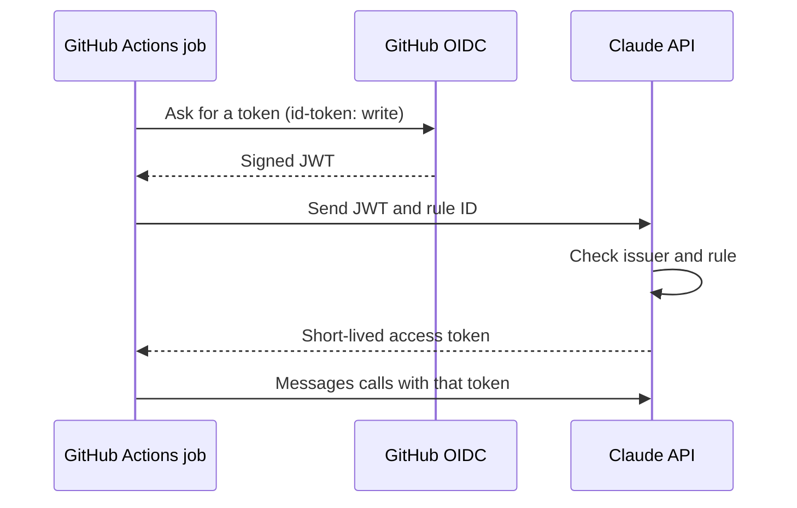

# Claude API

Set up two things first: the API credits in a Max, Ultra or Team plan, and keyless CI through workload identity federation (WIF).

| Account | Free tier | Login or key | Claude connector | OpenCode | Guard |
| --- | --- | --- | --- | --- | --- |
| A Claude Console organization at [platform.claude.com](https://platform.claude.com). A Max, Ultra or Team plan links to one organization, and needs no Claude Platform payment method ([API credits](https://platform.claude.com/docs/en/about-claude/api-credits-for-subscribers), read 2026-11-23). | Max $100, Ultra $200, Team $20 per Standard seat and $100 per Premium seat, each month. The page says Team credit is pooled and capped at $500. Free, Pro and Enterprise are not eligible ([API credits](https://platform.claude.com/docs/en/about-claude/api-credits-for-subscribers), read 2026-11-23). | CI: federation, no key. Otherwise one service account key per consumer in `ANTHROPIC_API_KEY` ([Authentication](https://platform.claude.com/docs/en/manage-claude/authentication), read 2026-11-23). | `anthropics/claude-code-action` takes the federation inputs ([Setup](https://github.com/anthropics/claude-code-action/blob/main/docs/setup.md), read 2026-11-23). | `anthropic`, env `ANTHROPIC_API_KEY` ([models.dev](https://models.dev/api.json), read 2026-11-23). | With no credits left, API requests stop until new credits arrive or you buy more ([API credits](https://platform.claude.com/docs/en/about-claude/api-credits-for-subscribers), read 2026-11-23). Leave auto-reload off. |

## Your credits

The plan credits cover the Claude API, Managed Agents, the Agent SDK and the Console Playground. They do not cover Claude Code. Unused credits expire at the end of each billing cycle ([API credits](https://platform.claude.com/docs/en/about-claude/api-credits-for-subscribers), read 2026-11-23).

The Console's [Billing page](https://platform.claude.com/settings/billing) lists them under **Promotional credits**, each with its amount and expiry date. Read it before a long run.

## CI without a key



## Set up

1. As an organization admin, open [Workload identity](https://platform.claude.com/settings/workload-identity-federation) in the Console and choose **Connect workload**, then the GitHub Actions tile. It creates the issuer, a service account and a rule, and tests the exchange ([WIF](https://platform.claude.com/docs/en/manage-claude/workload-identity-federation), read 2026-11-23).
2. Give the job `id-token: write` and pass the three IDs the wizard shows. They name identities, not secrets ([Setup](https://github.com/anthropics/claude-code-action/blob/main/docs/setup.md), read 2026-11-23). Plan credits cannot pay for the action, which runs Claude Code. On them, run the Agent SDK with these IDs, as `tools/reread_agent.py` does.

   ```yaml
   permissions:
     id-token: write
   steps:
     - uses: anthropics/claude-code-action@v1
       with:
         anthropic_federation_rule_id: <fdrl_ id>
         anthropic_organization_id: <organization id>
         anthropic_service_account_id: <svac_ id>
   ```

3. Set no API key next to it: a static key wins over federation. `ant auth status` shows which source won ([WIF](https://platform.claude.com/docs/en/manage-claude/workload-identity-federation), read 2026-11-23).
4. Use a key only when the client cannot exchange a token. A federated token goes in `Authorization: Bearer`, so a client that sends only `x-api-key` needs a key ([Authentication](https://platform.claude.com/docs/en/manage-claude/authentication), read 2026-11-23). Make a service account key for one workspace, pick an expiry of 3 hours to 30 days, and name it for its consumer, as in [Names](reference/names.md). Store it as a CI secret.

Traps and sources: [Claude API traps and sources](detail/claude-api.md).
