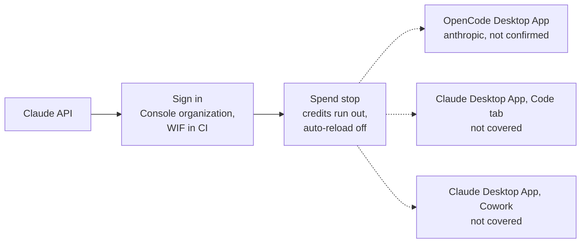

# Claude API

Max, Ultra and Team plans include monthly Claude API credits. GitHub Actions can call the API with no stored key through workload identity federation (WIF). The credits do not pay for the Desktop App.



| Account | Free tier | Login or key | Claude connector | OpenCode | Guard |
| --- | --- | --- | --- | --- | --- |
| A Claude Console organization linked to a Max, Ultra or Team plan ([API credits](https://platform.claude.com/docs/en/about-claude/api-credits-for-subscribers), read 2026-11-24). | Per the credits page, Max gets $100 a month, Ultra $200, Team $20 per Standard seat and $100 per Premium, pooled to $500. | CI: federation, no key. Otherwise a service account key in `ANTHROPIC_API_KEY` ([Authentication](https://platform.claude.com/docs/en/manage-claude/authentication), read 2026-11-24). | None. The credits exclude Claude Code and extra usage in the Claude apps ([API credits](https://platform.claude.com/docs/en/about-claude/api-credits-for-subscribers), read 2026-11-24). | `anthropic`, env `ANTHROPIC_API_KEY` ([models.dev](https://models.dev/api.json), read 2026-11-23). | With no credits left, API requests stop until new ones arrive ([API credits](https://platform.claude.com/docs/en/about-claude/api-credits-for-subscribers), read 2026-11-24). Leave auto-reload off. [More](detail/claude-api.md#guard). See [Git Crafter compute rules](https://github.com/SoulCraft-Org/git-crafter/blob/main/rules/compute.md). |

## Wiring

| Host | Plugs in as | Source |
| --- | --- | --- |
| OpenCode Desktop App | Not confirmed. OpenCode's providers page has no Anthropic section. The catalog lists `anthropic` with a key from the Console. | [OpenCode providers](https://opencode.ai/docs/providers), read 2026-11-24; [models.dev](https://models.dev/api.json), read 2026-11-23 |
| Claude Desktop App, Code tab | Not available. The credits cover the API, Managed Agents, the Agent SDK and the Playground. Its "Doesn’t cover" row lists Claude Code. | [API credits](https://platform.claude.com/docs/en/about-claude/api-credits-for-subscribers), read 2026-11-24 |
| Claude Desktop App, Cowork | Not available. Its "Doesn’t cover" row reads "Claude Code, extra usage in the Claude apps." | [API credits](https://platform.claude.com/docs/en/about-claude/api-credits-for-subscribers), read 2026-11-24 |

## Worked example: a doc re-read agent

A weekly job re-reads stale pages and pushes a branch for review. Limits from its [script](https://github.com/Colorado-Compute/compute-credits/blob/main/tools/reread_agent.py) and [workflow](https://github.com/Colorado-Compute/compute-credits/blob/main/.github/workflows/catalog-reread.yml), read 2026-11-25.

| Part | Setting |
| --- | --- |
| Sign-in | The job's OIDC token, no stored key |
| Reads | `catalog/**` and `AGENTS.md`. Its prompt caps the pages it fetches at 10 |
| Writes | One file. The workflow, not the agent, pushes the branch |
| Caps | 60 turns, a $3 budget per run, a 30 minute job |
| Never | Merges, or runs git |

<details>
<summary>Commands</summary>

```bash
ant auth status
```

```yaml
permissions:
  id-token: write
```

</details>

Guard and credits: [Claude API detail](detail/claude-api.md). Keyless CI: [Claude API CI](detail/claude-api-ci.md). Traps and sources: [Claude API traps and sources](detail/claude-api-traps.md).
