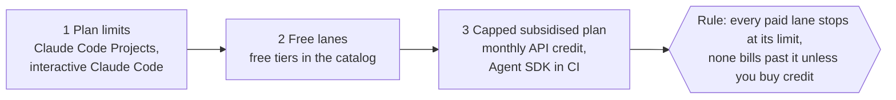

# Claude Code Projects

Claude Code Projects run on your Claude plan's usage limits. The monthly API credit pays for other surfaces. Keep the two apart, and stop every paid lane at its limit.

| Account | Free tier | Login or key | Claude connector | OpenCode | Guard |
| --- | --- | --- | --- | --- | --- |
| A Max or Ultra plan, with a Claude Console organization linked ([credits](https://support.claude.com/en/articles/17154008-monthly-api-credits-for-max-ultra-and-team-plans), read 2026-11-25). | Max gets $100 a month in API credit and Ultra $200 ([credits](https://support.claude.com/en/articles/17154008-monthly-api-credits-for-max-ultra-and-team-plans), read 2026-11-25). Unused credit does not roll over (same page). | Claude sign-in on claude.ai/code or the Desktop App, for Projects. An API key from the linked organization for the credit. | None. Projects run in Claude Code, not through a connector. | Not applicable. | Plan limits pause threads. Past them, work continues only if usage credits are on ([Projects](https://code.claude.com/docs/en/claude-projects), read 2026-11-25). Keep them off. |

## Wiring

| Host | Plugs in as | Source |
| --- | --- | --- |
| OpenCode Desktop App | Not confirmed. OpenCode's providers page names no Projects feature. | [OpenCode providers](https://opencode.ai/docs/providers), read 2026-11-25 |
| Claude Desktop App, Code tab | Not a connection. Projects is the Code tab's own feature, so there is nothing to wire. | [Projects](https://code.claude.com/docs/en/claude-projects), read 2026-11-25 |
| Claude Desktop App, Cowork | Not available. The monthly API credit excludes the Claude apps. | [Credits](https://support.claude.com/en/articles/17154008-monthly-api-credits-for-max-ultra-and-team-plans), read 2026-11-25 |

## What draws on what

| Surface | Draws on | Source |
| --- | --- | --- |
| Claude API, Console Playground, Managed Agents | The monthly API credit | [Credits](https://support.claude.com/en/articles/17154008-monthly-api-credits-for-max-ultra-and-team-plans), read 2026-11-25 |
| Agent SDK, and `claude -p` run with an API key from the linked organization | The monthly API credit | Same page |
| `claude -p` and the Agent SDK signed in with your plan | Plan usage limits | Same page |
| Interactive Claude Code in the terminal, IDE, desktop or web | Plan usage limits. The credit does not cover it | Same page |
| The Desktop app, an IDE extension, the Claude Code GitHub Action | Plan usage limits. The credit does not cover them, even with `-p` | Same page |
| Claude Code Projects threads | Plan usage limits | [Projects](https://code.claude.com/docs/en/claude-projects), read 2026-11-25 |

## Projects facts

| Fact | Source |
| --- | --- |
| Projects are a public beta on Pro, Max and Ultra. They are not offered on Team yet. | [Projects](https://code.claude.com/docs/en/claude-projects), read 2026-11-25 |
| A cloud thread runs with approximate ceilings of 4 vCPUs, 16 GB of RAM and 30 GB of disk, which may change. | [Cloud environments](https://code.claude.com/docs/en/cloud-environments), read 2026-11-25 |
| The catalog row for cloud sessions lists no separate charge for the VM. Usage counts toward the plan's limits. | [Catalog](https://github.com/Colorado-Compute/compute-credits/blob/main/catalog/plans.json), checked 2026-11-23 |
| The cache lifetime is an hour. A thread idle longer re-reads its whole conversation on the next message, so start a fresh thread for new work. | [Projects](https://code.claude.com/docs/en/claude-projects), read 2026-11-25 |
| **Usage** in **Project settings** shows token use by thread. | [Projects](https://code.claude.com/docs/en/claude-projects), read 2026-11-25 |
| An idle thread watching a pull request wakes and uses the plan again when CI fails or a review arrives. | [Projects](https://code.claude.com/docs/en/claude-projects), read 2026-11-25 |

## Claude in CI with no stored key

Run the Agent SDK in GitHub Actions over workload identity federation. The job holds no key. The monthly credit pays for it once the Console organization is linked. Steps: [Claude API CI](detail/claude-api-ci.md). Guard: [Claude API](claude-api.md).

## Set up in four steps

| Step | Do | Source |
| --- | --- | --- |
| 1 | Link one Console organization from Billing settings on claude.ai, as the subscriber on Max or Ultra. Wait seven days on the plan first. | [Credits](https://support.claude.com/en/articles/17154008-monthly-api-credits-for-max-ultra-and-team-plans), read 2026-11-25 |
| 2 | Claim the monthly credit. It is spent before any purchased credit. Amounts: Max $100 and Ultra $200 per the credits page. | Same page |
| 3 | Set Extra usage off, and keep usage credits off. Buy no extra credit, so API use stops when the monthly credit runs out. | [Projects](https://code.claude.com/docs/en/claude-projects), read 2026-11-25 |
| 4 | Run the setup check in [Projects README](https://github.com/SoulCraft-Org/git-crafter/blob/main/templates/projects/README.md). | Linked page |

## Prices

Plan prices come only from the public catalog: Max is $100 a month and Ultra $200 ([catalog](https://github.com/Colorado-Compute/compute-credits/blob/main/catalog/plans.json), checked 2026-11-23). Both rows list the overage as `stops`. Rules for every lane: [Git Crafter compute rules](https://github.com/SoulCraft-Org/git-crafter/blob/main/rules/compute.md).
