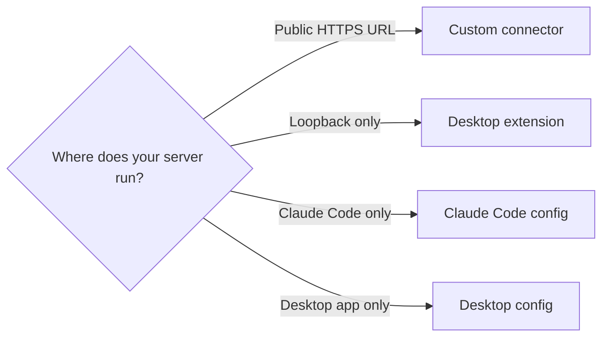

# Claude Desktop: one MCP server for the Code tab and Cowork

The Claude desktop app has two places that use MCP tools: the Code tab (Claude Code) and Cowork. This guide picks the route that gives one server to both.

| Your server | Use | Reaches | Who adds it | Source |
| --- | --- | --- | --- | --- |
| A public HTTPS URL | A custom connector. | claude.ai, the mobile app, and the desktop app's chat, Cowork and Code tab. Claude Code in a terminal too, when signed in with a Claude account. | Free, Pro, Max and Ultra: you, at Customize > Connectors. Team and Enterprise: an Owner adds it for the organization. Each member then connects. | [Custom connectors](https://support.claude.com/en/articles/11175166-get-started-with-custom-connectors-using-remote-mcp), [unlisted connectors](https://claude.com/docs/connectors/custom/add-unlisted), [Claude Code MCP](https://code.claude.com/docs/en/mcp#how-connectors-reach-claude-code), read 2026-11-20 |
| An app that listens only on `127.0.0.1` | A desktop extension (`.mcpb`) built from [loopback-bridge/](loopback-bridge/). | The desktop app on that computer: Cowork and the Code tab's local sessions (source: a test on 2026-11-20). Not claude.ai, the mobile app or cloud sessions. | You, on each computer. Installation is per user. | [MCPB page](https://claude.com/docs/connectors/building/mcpb), read 2026-11-20 |
| A server in `~/.claude.json` or `.mcp.json` | Claude Code's own config. | Claude Code only, the Code tab included. Cowork takes its connectors from your Claude account, not from `~/.claude`. | You, with `claude mcp add`. | [Desktop docs](https://code.claude.com/docs/en/desktop#extend-claude-code), read 2026-11-20 |
| A server in `claude_desktop_config.json` | Claude Desktop's local config. | The desktop app, and a Cowork session running on this computer. Not claude.ai or cloud Cowork. | You. Claude Code copies it with `claude mcp add-from-claude-desktop`. | [Custom connectors](https://support.claude.com/en/articles/11175166-get-started-with-custom-connectors-using-remote-mcp), [Claude Code MCP](https://code.claude.com/docs/en/mcp#import-mcp-servers-from-claude-desktop), read 2026-11-20 |

## Set up: a remote server

1. On Free, Pro, Max or Ultra, go to Customize > Connectors, select Add, then Add custom connector.
2. On Team or Enterprise, an Owner goes to Organization settings > Connectors, selects Add, then Custom, then Web.
3. Enter a name and the server URL exactly as the provider documents it, path included, such as `https://example.com/mcp`. Keep any authentication option marked Detected unless the server's docs say otherwise. Select Add.
4. On Team or Enterprise, each member goes to Customize > Connectors, finds the connector labeled Custom, and selects Connect.
5. For a read-only docs connector, open its page under Customize > Connectors. Under Tool permissions, set the group of read-only tools to Always allow, so Cowork stops asking before every lookup. Leave write tools at Needs approval.
6. Start a new Code tab session. A session that was already open did not list a new connector (source: a test on 2026-11-20).

For an app on this computer only, see [the loopback bridge](claude-desktop-mcp/loopback.md). Traps and sources: [Claude Desktop MCP traps and sources](claude-desktop-mcp/traps.md).
