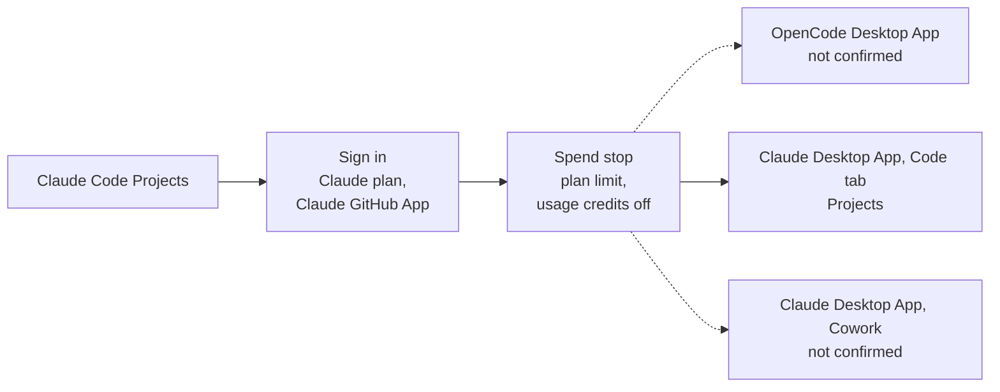

# Claude Code Projects

A Project is one Claude conversation that starts cloud threads, each on its own branch and pull request. It runs on a Claude plan with no extra bill unless usage credits are on.

| Account | Free tier | Login or key | Claude connector | OpenCode | Guard |
| --- | --- | --- | --- | --- | --- |
| A Claude Pro, Max or Ultra plan, in public beta and rolling out gradually. Not Team or Enterprise ([Projects](https://code.claude.com/docs/en/claude-projects), read 2026-11-25). | No separate free tier: threads draw on the plan's usage limits ([Projects](https://code.claude.com/docs/en/claude-projects), read 2026-11-25). | The Claude sign-in, and the Claude GitHub App installed on each repository ([Projects](https://code.claude.com/docs/en/claude-projects), read 2026-11-25). | Account connectors reach cloud threads. A repository's `.mcp.json` servers do not ([Projects](https://code.claude.com/docs/en/claude-projects), read 2026-11-25). | Not confirmed. Projects documents `CLAUDE.md`, not `AGENTS.md` ([Projects](https://code.claude.com/docs/en/claude-projects), read 2026-11-25). | A thread at the plan limit waits and, by default, continues at the reset. A project setting turns that off. Work goes past the limit only with usage credits on. 500 new threads a day ([Projects](https://code.claude.com/docs/en/claude-projects), read 2026-11-25). |

## Wiring

| Host | Plugs in as | Source |
| --- | --- | --- |
| OpenCode Desktop App | Not confirmed. A Project is a Claude feature, and its docs name `CLAUDE.md`, not `AGENTS.md`. | [Projects](https://code.claude.com/docs/en/claude-projects), read 2026-11-25 |
| Claude Desktop App, Code tab | Projects, in the sidebar. A thread can run on your own computer through Remote Control. | [Projects](https://code.claude.com/docs/en/claude-projects), read 2026-11-25 |
| Claude Desktop App, Cowork | Not confirmed. | [Projects](https://code.claude.com/docs/en/claude-projects), read 2026-11-25 |

Set up a Project, and what a cloud thread loads: [Git Crafter projects template](https://github.com/SoulCraft-Org/git-crafter/tree/main/templates/projects), with [limits and cost](https://github.com/SoulCraft-Org/git-crafter/blob/main/templates/projects/threads.md).
