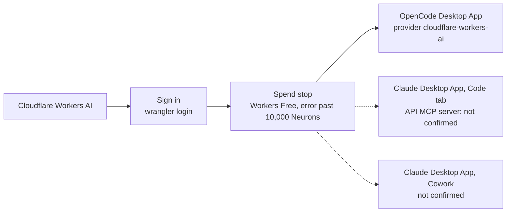

# Cloudflare Workers AI

Cloudflare Workers AI gives the OpenCode Desktop App open-weight models on Cloudflare's network, with a free daily Neurons allocation. Cloudflare hosts MCP servers; no page confirms the Claude Desktop App.



| Account | Free tier | Login or key | Claude connector | OpenCode | Guard |
| --- | --- | --- | --- | --- | --- |
| A Cloudflare account on Workers Free. | 10,000 Neurons a day, reset at 00:00 UTC ([Pricing](https://developers.cloudflare.com/workers-ai/platform/pricing/), read 2026-11-24). | `wrangler login`; the REST API takes a Workers AI token. | `https://mcp.cloudflare.com/mcp`, OAuth ([MCP servers](https://developers.cloudflare.com/agents/model-context-protocol/mcp-servers-for-cloudflare/), read 2026-11-24). | `cloudflare-workers-ai` ([models.dev](https://models.dev), read 2026-11-20). | On Free, use past the allocation fails with an error ([Pricing](https://developers.cloudflare.com/workers-ai/platform/pricing/), read 2026-11-24). Workers Paid removes the stop. [Detail](detail/cloudflare-workers-ai.md#guard). See [Git Crafter compute rules](https://github.com/SoulCraft-Org/git-crafter/blob/main/rules/compute.md). |

## Wiring

| Host | Plugs in as | Source |
| --- | --- | --- |
| OpenCode Desktop App | Connect provider Workers AI with a token, and give OpenCode the account ID. | [REST API](https://developers.cloudflare.com/workers-ai/get-started/rest-api/) (read 2026-11-12), [CLI providers](https://opencode.ai/docs/cli/providers) (read 2026-11-20) |
| Claude Desktop App, Code tab | Not confirmed. The page names "Claude" and a Skills plugin for Claude Code, not a Desktop tab. The MCP URL takes no models. | [MCP servers](https://developers.cloudflare.com/agents/model-context-protocol/mcp-servers-for-cloudflare/), read 2026-11-24 |
| Claude Desktop App, Cowork | Not confirmed. The page does not name Cowork. | [MCP servers](https://developers.cloudflare.com/agents/model-context-protocol/mcp-servers-for-cloudflare/), read 2026-11-24 |

<details>
<summary>Commands</summary>

```bash
npx wrangler login --use-keyring
opencode auth login cloudflare-workers-ai --method key
opencode service set env CLOUDFLARE_ACCOUNT_ID <account-id>
```

Enter the token at the hidden prompt. The account ID is an identifier, not a secret.

</details>

Guard and set up: [Cloudflare Workers AI detail](detail/cloudflare-workers-ai.md). Traps and sources: [Cloudflare Workers AI traps and sources](detail/cloudflare-workers-ai-traps.md).
