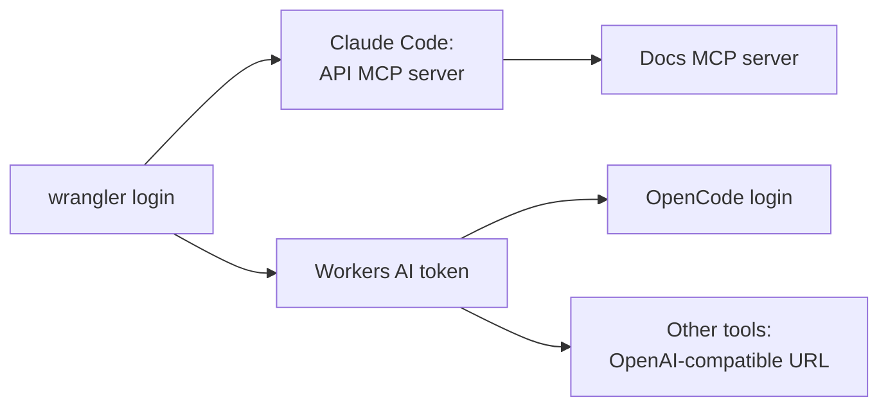

# Cloudflare Workers AI

Cloudflare Workers AI gives a Claude Code or OpenCode user open-weight models on Cloudflare's network, with a free daily Neurons allocation and hosted MCP servers.

| Account | Free tier | Login or key | Claude connector | OpenCode | Guard |
| --- | --- | --- | --- | --- | --- |
| Anyone with a Cloudflare account on the Workers Free plan. | 10,000 Neurons per day at no charge, on Workers Free and Workers Paid ([Pricing](https://developers.cloudflare.com/workers-ai/platform/pricing/), read 2026-11-12). All limits reset daily at 00:00 UTC ([Pricing](https://developers.cloudflare.com/workers-ai/platform/pricing/), read 2026-11-12). | `wrangler login` (browser OAuth); for the REST API, a Workers AI API token. | `https://mcp.cloudflare.com/mcp` ([Cloudflare's own MCP servers](https://developers.cloudflare.com/agents/model-context-protocol/mcp-servers-for-cloudflare/), read 2026-11-12). | `cloudflare-workers-ai` ([models.dev](https://models.dev), read 2026-11-12). | On Workers Free, use past the allocation fails with an error ([Pricing](https://developers.cloudflare.com/workers-ai/platform/pricing/), read 2026-11-12). Upgrading to Workers Paid removes the stop: $5 USD per month minimum ([Workers Pricing](https://developers.cloudflare.com/workers/platform/pricing/), read 2026-11-12), then $0.011 per 1,000 Neurons above the allocation ([Pricing](https://developers.cloudflare.com/workers-ai/platform/pricing/), read 2026-11-12). On Paid, Cloudflare's account spending limits do not cover Workers AI ([Spending limits and alerts](https://developers.cloudflare.com/billing/manage/spend-management/), read 2026-11-20). An AI Gateway spend limit stops the requests routed through a gateway ([AI Gateway spend limits](https://developers.cloudflare.com/ai-gateway/features/spend-limits/), read 2026-11-20). See [Git Crafter compute rules](https://github.com/SoulCraft-Org/git-crafter/blob/main/rules/compute.md). |



## Set up

1. Sign in Wrangler with the browser OAuth flow. `--use-keyring` keeps the credentials in the OS keychain instead of a plain TOML file ([General commands](https://developers.cloudflare.com/workers/wrangler/commands/general/), read 2026-11-12).

```bash
npx wrangler login --use-keyring
npx wrangler whoami
```

2. Add Cloudflare's API MCP server to Claude Code, then sign in with OAuth. Cloudflare's page calls it the only server most users need.

```bash
claude mcp add --transport http cloudflare-api https://mcp.cloudflare.com/mcp
claude mcp login cloudflare-api
```

Grant only the permissions you need on Cloudflare's consent screen. The Cloudflare Skills plugin installs the same servers: run `/plugin marketplace add cloudflare/skills` inside Claude Code.

3. Add the docs server too, if you want Cloudflare's documentation in context.

```bash
claude mcp add --transport http cloudflare-docs https://docs.mcp.cloudflare.com/mcp
```

4. Connect Workers AI as a model provider in OpenCode. In the dashboard, open Workers AI, select **Use REST API**, then **Create a Workers AI API Token** ([REST API](https://developers.cloudflare.com/workers-ai/get-started/rest-api/), read 2026-11-12). Copy the Account ID from the same screen.

```bash
opencode auth login cloudflare-workers-ai --method key
```

Enter the token at the hidden prompt. OpenCode's catalog reads `CLOUDFLARE_ACCOUNT_ID` and `CLOUDFLARE_API_KEY` ([models.dev](https://models.dev), read 2026-11-20). OpenCode's shared background service does not see your shell, so give it the account ID, which is an identifier, not a secret ([CLI providers](https://opencode.ai/docs/cli/providers), read 2026-11-20). See [OpenCode 2](README.md#opencode-2).

```bash
opencode service set env CLOUDFLARE_ACCOUNT_ID <account-id>
```

5. Any other OpenAI-compatible tool uses base URL `https://api.cloudflare.com/client/v4/accounts/{account_id}/ai/v1` with the token as a bearer header ([OpenAI compatible API endpoints](https://developers.cloudflare.com/workers-ai/configuration/open-ai-compatibility/), read 2026-11-12).

Traps and sources: [Cloudflare Workers AI traps and sources](detail/cloudflare-workers-ai.md).
