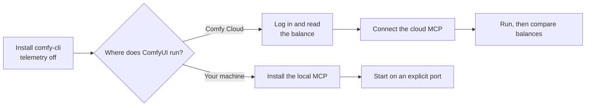

# ComfyUI

ComfyUI runs open-weight image and video workflows, and its MCP servers let Claude Code drive it on Comfy Cloud, a rented GPU or your own box.

| Account | Free tier | Login or key | Claude connector | OpenCode | Guard |
| --- | --- | --- | --- | --- | --- |
| A Comfy account for Comfy Cloud. Whether the Free plan needs a card is not published. Self-hosted ComfyUI needs no account | Free: "5 free runs on real GPUs and free Comfy Agent credits for new users". Standard: $20 a month or $192 billed yearly, 50,400 credits per year ([Comfy Cloud pricing](https://www.comfy.org/cloud/pricing), read 2026-11-12) | `comfy cloud login` (browser OAuth with PKCE). MCP: OAuth through `/mcp` | Comfy Cloud MCP `https://cloud.comfy.org/mcp`: `claude mcp add --transport http comfy-cloud https://cloud.comfy.org/mcp`. Local: `comfy-mcp` | None as a model provider. Add the Cloud MCP with `opencode mcp add` | Plan credits pay for GPU time and Partner Nodes; top-ups are manual ([Comfy Cloud pricing](https://www.comfy.org/cloud/pricing), read 2026-11-12). Buying a top-up raises the stop. [Git Crafter compute rules](https://github.com/SoulCraft-Org/git-crafter/blob/main/rules/compute.md), [Git Crafter Comfy rules](https://github.com/SoulCraft-Org/git-crafter/blob/main/rules/comfy.md) |



## Set up

1. To run ComfyUI on a GPU you rent or own, use [ComfyUI Base](https://github.com/SoulCraft-Org/comfyui-base). Its README and handbook hold the installer, the per-host recipes and its MCP driver.
2. Install comfy-cli ([Comfy CLI getting started](https://docs.comfy.org/comfy-cli/getting-started), read 2026-11-12). Turn its telemetry off.

   ```bash
   pip install comfy-cli
   comfy tracking disable
   ```

3. For Comfy Cloud, log in and read the balance before any run.

   ```bash
   comfy cloud login
   comfy cloud whoami
   comfy cloud status
   ```

4. Connect the Comfy Cloud MCP. Generations need an active Comfy Cloud subscription; searching templates, models and nodes is free ([Comfy MCP](https://docs.comfy.org/agent-tools/mcp), read 2026-11-12).

   ```bash
   claude mcp add --transport http comfy-cloud -s user https://cloud.comfy.org/mcp
   opencode mcp add comfy-cloud --global --url https://cloud.comfy.org/mcp
   ```

   In Claude Code, run `/mcp`, pick **comfy-cloud** and choose **Authenticate**.

5. For a ComfyUI on your own machine, install the local server and register it ([Comfy MCP local](https://docs.comfy.org/agent-tools/local), read 2026-11-12). Set `COMFY_BIN` with `-e` only when `comfy` is off the client's PATH.

   ```bash
   pip install comfy-mcp
   claude mcp add comfy-mcp --scope user -- comfy-mcp
   ```

6. Start a local ComfyUI on an explicit port, not the vendor default. Arguments after `--` go to ComfyUI.

   ```bash
   comfy launch -- --listen 127.0.0.1 --port 3103
   ```

7. Agent skills install with `comfy skills install`; `comfy skills list` names them.
8. After a paid run, run `comfy cloud status` again and compare the two balances.

Traps and sources: [ComfyUI traps and sources](detail/comfyui.md).
