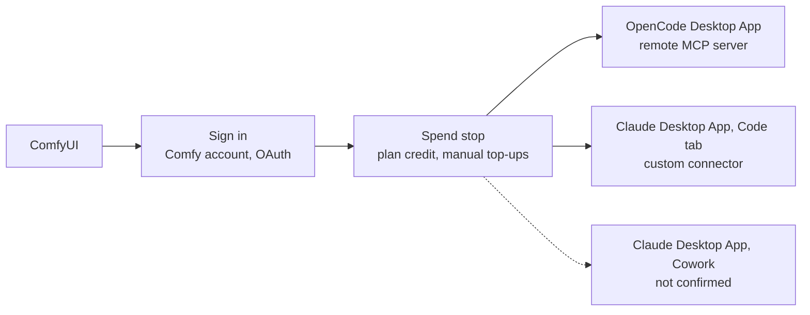

# ComfyUI

ComfyUI runs open-weight image and video workflows. Comfy Cloud's MCP server lets the Claude Desktop App drive it, and a local one drives a ComfyUI on your own machine.



| Account | Free tier | Login or key | Claude connector | OpenCode | Guard |
| --- | --- | --- | --- | --- | --- |
| A Comfy account for Comfy Cloud. Self-hosted ComfyUI needs none ([Comfy MCP](https://docs.comfy.org/agent-tools/mcp), read 2026-11-24). | Free plan, $0: 5 free runs and free Comfy Agent credits ([Comfy Cloud pricing](https://www.comfy.org/cloud/pricing), read 2026-11-24). | `comfy cloud login`, a browser sign-in. MCP: OAuth. | `https://cloud.comfy.org/mcp` ([Comfy MCP](https://docs.comfy.org/agent-tools/mcp), read 2026-11-24). | `opencode mcp add comfy-cloud --global --url https://cloud.comfy.org/mcp` ([OpenCode MCP servers](https://opencode.ai/docs/mcp-servers), read 2026-11-24). | Plan credit, then manual top-ups. Comfy Cloud has no team spending limits and no auto-recharge, and says it is building them ([Comfy Cloud pricing](https://www.comfy.org/cloud/pricing), read 2026-11-24). [Guard detail](detail/comfyui.md#guard). See [Git Crafter compute rules](https://github.com/SoulCraft-Org/git-crafter/blob/main/rules/compute.md). |

## Wiring

| Host | Plugs in as | Source, read 2026-11-24 |
| --- | --- | --- |
| OpenCode Desktop App | Comfy: any MCP client with remote HTTP transport can connect. OpenCode documents remote servers under `mcp`, with OAuth on by default. | [Comfy MCP](https://docs.comfy.org/agent-tools/mcp), [OpenCode MCP servers](https://opencode.ai/docs/mcp-servers) |
| Claude Desktop App, Code tab | Customize, Connectors, Add custom connector, the URL above (Comfy). Connectors added with the plus button reach local Code sessions (Desktop docs). | [Comfy MCP](https://docs.comfy.org/agent-tools/mcp), [Desktop docs: Connect external tools](https://code.claude.com/docs/en/desktop) |
| Claude Desktop App, Cowork | Not confirmed. Comfy's page does not mention Cowork. Cowork takes connectors from your claude.ai account. | [Comfy MCP](https://docs.comfy.org/agent-tools/mcp), [Desktop docs](https://code.claude.com/docs/en/desktop) |

The local `comfy-mcp` has its own Claude Desktop step, an edit to `claude_desktop_config.json` ([Comfy MCP local](https://docs.comfy.org/agent-tools/local), read 2026-11-24).

<details>
<summary>Commands</summary>

```bash
pip install comfy-cli
comfy tracking disable
comfy cloud login
comfy cloud whoami
comfy cloud status
opencode mcp add comfy-cloud --global --url https://cloud.comfy.org/mcp
comfy skills install
comfy skills list
pip install comfy-mcp
comfy launch -- --listen 127.0.0.1 --port 3103
```

</details>

Guard and set up: [ComfyUI detail](detail/comfyui.md). Traps and sources: [ComfyUI traps and sources](detail/comfyui-traps.md).
