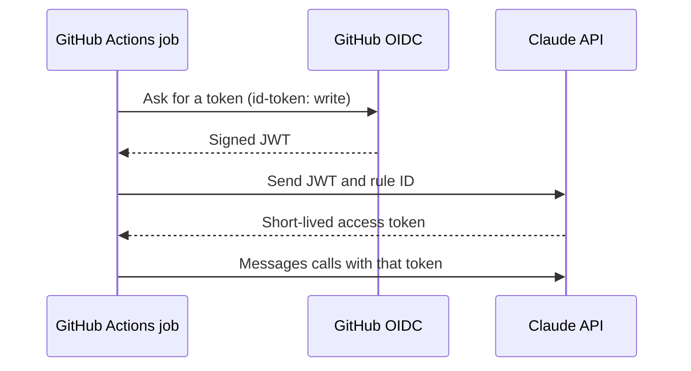

# Claude API: guard, credits and keyless CI

What the Claude API guide moved out of its page. Traps and sources: [Claude API traps and sources](claude-api-traps.md). The diagram and wiring are in [Claude API](../claude-api.md).

## Guard

| Item | Detail | Source |
| --- | --- | --- |
| Covered | Claude API, Managed Agents, the Agent SDK and the Playground | [API credits](https://platform.claude.com/docs/en/about-claude/api-credits-for-subscribers), read 2026-11-24 |
| Not covered | Claude Code, extra usage in the Claude apps, cloud platforms | [API credits](https://platform.claude.com/docs/en/about-claude/api-credits-for-subscribers), read 2026-11-24 |
| Expiry | End of each billing cycle, no rollover | [API credits](https://platform.claude.com/docs/en/about-claude/api-credits-for-subscribers), read 2026-11-24 |
| Order | Included credits first, then purchased ones. Auto-reload counts only the purchased balance | [API credits](https://platform.claude.com/docs/en/about-claude/api-credits-for-subscribers), read 2026-11-24 |
| At zero | Requests stop, and usage is never charged to your plan. Buying credits or auto-reload removes the stop | [API credits](https://platform.claude.com/docs/en/about-claude/api-credits-for-subscribers), read 2026-11-24 |
| Eligibility | Free, Pro and Enterprise are not eligible. New subscribers claim after 7 days | [API credits](https://platform.claude.com/docs/en/about-claude/api-credits-for-subscribers), read 2026-11-24 |

Read the Console's [Billing page](https://platform.claude.com/settings/billing) before a long run. It lists **Promotional credits** with amounts and expiry dates.

## CI without a key

## Set up

1. As an organization admin, open [Workload identity](https://platform.claude.com/settings/workload-identity-federation), choose **Connect workload**, then the GitHub Actions tile. It creates the issuer, a service account and a rule, and tests the exchange ([WIF](https://platform.claude.com/docs/en/manage-claude/workload-identity-federation), read 2026-11-24).
2. Give the job `id-token: write` and pass the three IDs the wizard shows. They name identities, not secrets ([Setup](https://github.com/anthropics/claude-code-action/blob/main/docs/setup.md), read 2026-11-23). Plan credits cannot pay for `claude-code-action`. On them, run the Agent SDK with these IDs, as the re-read agent in [Colorado-Compute/compute-credits](https://github.com/Colorado-Compute/compute-credits/blob/main/tools/reread_agent.py) does.
3. Set no API key next to it: a static key wins over federation. `ant auth status` shows which source won ([WIF](https://platform.claude.com/docs/en/manage-claude/workload-identity-federation), read 2026-11-24).
4. Use a key only when the client cannot exchange a token. Make a service account key for one workspace, pick an expiry of 3 hours to 30 days, and name it as in [Names](../reference/names.md). Store it as a CI secret ([Authentication](https://platform.claude.com/docs/en/manage-claude/authentication), read 2026-11-23).
