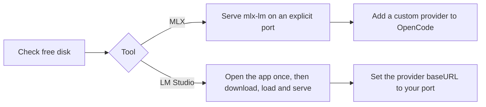

# Local models: set up

What the Local models guide moved out of its page. Traps and sources: [Local models traps and sources](local-models-traps.md). The diagram and wiring are in [Local models](../local-models.md).

## Set up

1. Check free disk before any download. A model is several GB, and both tools download on demand. Run one download at a time.
2. MLX: install `mlx-lm` and serve on an explicit port. The server downloads a Hugging Face repo it has not cached ([mlx-lm README](https://github.com/ml-explore/mlx-lm), read 2026-11-12).
3. OpenCode with MLX: add a custom provider to `opencode.jsonc`, with the package `@opencode/ai/providers/openai-compatible` and `settings.baseURL`. List each model by hand. The provider key becomes the model prefix ([OpenCode providers](https://opencode.ai/docs/providers), read 2026-11-24).
4. LM Studio: open the app once so `lms` works ([lms CLI](https://lmstudio.ai/docs/cli), read 2026-11-12). Then download, load and serve on your port.
5. OpenCode with LM Studio: its default is `http://127.0.0.1:1234/v1`. Set `providers.lmstudio.settings.baseURL` to your port, then pick the model in `/models` ([OpenCode providers](https://opencode.ai/docs/providers), read 2026-11-24).
6. If you turn on **Require Authentication**, LM Studio accepts an `x-api-key` or bearer token. Keep the token in your password manager ([Anthropic compatibility](https://lmstudio.ai/docs/developer/anthropic-compat), read 2026-11-24).
7. Claude Desktop App: not confirmed. Check the [Gateway page](https://claude.com/docs/third-party/claude-desktop/gateway) before you point Desktop at a local server.
