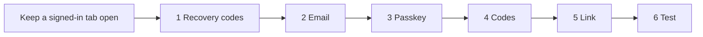

# Logins: six steps and the catalog

The steps to move one account to the starter's order, and the catalog's size. The order and the places are in [Logins](../logins.md). What goes wrong: [Logins traps](logins-traps.md).

## One account, six steps



| Step | Rule |
| --- | --- |
| 1 Recovery codes | Save new codes before you change anything |
| 2 Email | Set the email before you link Apple: some vendors unlink Apple when the email changes |
| 3 Passkey | Add it, then check that Passwords offers it at the next sign-in |
| 4 Codes | Enrol the code in the right app and confirm it with a fresh code |
| 5 Link | Link from account settings, never by a fresh sign-in through a second provider |
| 6 Test | Sign out in a private window and sign in with the new method |

Harden the identity providers first: every vendor you reach through one inherits its security. Remove an old factor only after all six steps pass.

## The catalog

| Rows | Verified | Passkey offered | Social sign-in only |
| --- | --- | --- | --- |
| 66 | 58 | 13 | 8 |

Counts are from `catalog/logins.json`, counted on 2026-11-24. A `null` field means the vendor's own pages did not say. Fill one in through [CONTRIBUTING.md](../../CONTRIBUTING.md) or the Sign-in facts issue form.

## Commands

<details>
<summary>Commands</summary>

```bash
bash templates/logins/sheet.sh catalog/logins.json sites.json
bash templates/logins/sheet.sh catalog/logins.json sites.json --json status.json
```

</details>
