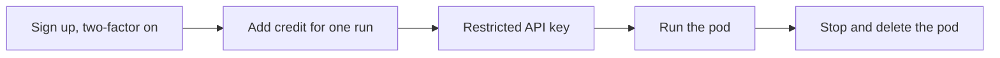

# RunPod: guard and set up

What the RunPod guide moved out of its page. Traps and sources: [RunPod traps and sources](runpod-traps.md). The diagram and wiring are in [RunPod](../runpod.md).

## Guard

| Spend | Stop | Source |
| --- | --- | --- |
| Pods and endpoints | Credit is prepaid and deducted in real time. At zero balance RunPod stops all running pods | [Billing](https://docs.runpod.io/accounts-billing/billing), read 2026-11-24 |
| Rate | Default spend limit: $80 an hour across all resources, raised over time by account history | [Billing](https://docs.runpod.io/accounts-billing/billing), read 2026-11-24 |
| Auto-pay | It charges the saved card when the balance nears your threshold, at most once an hour. Leave it off | [Billing](https://docs.runpod.io/accounts-billing/billing), read 2026-11-24 |
| Warning | A low-balance email works without auto-pay: set the threshold under General notifications | [Billing](https://docs.runpod.io/accounts-billing/billing), read 2026-11-24 |

## Set up

1. Sign up at the [RunPod console](https://console.runpod.io/signup), verify your email and turn on two-factor auth ([Get started](https://docs.runpod.io/get-started), read 2026-11-24).
2. Add credit only for the run you plan. A pod needs at least one hour of credit for its configuration. You can start with $10 ([Billing](https://docs.runpod.io/accounts-billing/billing), read 2026-11-24).
3. Claude Desktop App: Settings, Connectors, Add custom connector, `https://mcp.runpod.io/`, Add. The browser then signs you in. The session key is not stored on disk ([MCP servers](https://docs.runpod.io/get-started/mcp-servers), read 2026-11-24).
4. OpenCode Desktop App: add the remote server from the commands block, then run `opencode mcp auth runpod`. OpenCode keeps remote servers under `mcp` with `"type": "remote"` ([MCP servers](https://opencode.ai/docs/mcp-servers), read 2026-11-24).
5. CLI key: Credentials, API Keys, Create API Key, then **Restricted**. RunPod does not store it, so save it in your password manager ([API keys](https://docs.runpod.io/get-started/api-keys), read 2026-11-24).
6. Run `runpodctl doctor` and paste the key at its prompt. New config files use mode 0600 in a 0700 directory, and `~/.runpod/config.toml` is one place the setting can live ([runpodctl README](https://github.com/runpod/runpodctl), read 2026-11-24). Stop and delete each pod when the run ends.
7. Optional docs server: `https://docs.runpod.io/mcp`, no authentication, added the same way as step 3 or 4 ([MCP servers](https://docs.runpod.io/get-started/mcp-servers), read 2026-11-24).
8. For ComfyUI on a pod, use the [ComfyUI Base installer](https://github.com/SoulCraft-Org/comfyui-base).
