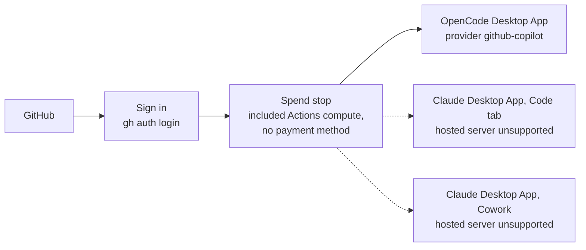

# GitHub

GitHub gives the OpenCode Desktop App Copilot models and a hosted MCP server, plus free CI on Actions. Claude Desktop does not support that server.



| Account | Free tier | Login or key | Claude connector | OpenCode | Guard |
| --- | --- | --- | --- | --- | --- |
| Anyone with an email, on the GitHub Free plan. | Standard runners are free in public repositories. Free plans include $12 USD of compute a month ([Actions billing](https://docs.github.com/en/billing/concepts/product-billing/github-actions), read 2026-11-24). | `gh auth login --web` (browser OAuth). Automation uses a GitHub App. | `https://api.githubcopilot.com/mcp`, unsupported in Claude Desktop ([Install in Claude](https://github.com/github/github-mcp-server/blob/main/docs/installation-guides/install-claude.md), read 2026-11-24). | `github-copilot`, through `/connect` ([OpenCode providers](https://opencode.ai/docs/providers), read 2026-11-24). | With no payment method, Actions stop when the included compute is spent ([Actions billing](https://docs.github.com/en/billing/concepts/product-billing/github-actions), read 2026-11-24). [More](detail/github.md#guard). See [Git Crafter compute rules](https://github.com/SoulCraft-Org/git-crafter/blob/main/rules/compute.md). |

## Wiring

| Host | Plugs in as | Source |
| --- | --- | --- |
| OpenCode Desktop App | `/connect`, GitHub Copilot, Login with GitHub Copilot (device code). The account needs Copilot Chat access; Copilot Free counts. | [OpenCode providers](https://opencode.ai/docs/providers), read 2026-11-24 |
| Claude Desktop App, Code tab | Not available for the hosted server: its OAuth "is not currently supported" in Claude Desktop. Desktop names GitHub as a tool; PR monitoring needs `gh` installed and signed in. | [Install in Claude](https://github.com/github/github-mcp-server/blob/main/docs/installation-guides/install-claude.md), read 2026-11-24; [Desktop docs](https://code.claude.com/docs/en/desktop), read 2026-11-24 |
| Claude Desktop App, Cowork | Not available for the hosted server, for the same reason. GitHub offers a local Docker server instead. | [Install in Claude](https://github.com/github/github-mcp-server/blob/main/docs/installation-guides/install-claude.md), read 2026-11-24 |

<details>
<summary>Commands</summary>

```bash
gh auth login --web --git-protocol https
gh auth status
opencode auth login
```

</details>

Guard, set up and App manifest: [GitHub detail](detail/github.md). Traps and sources: [GitHub traps and sources](detail/github-traps.md).
