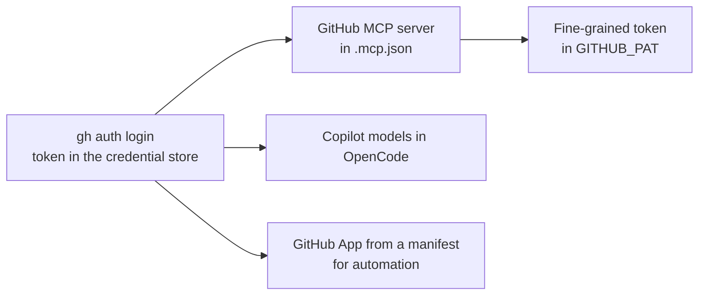

# GitHub

GitHub gives a Claude Code or OpenCode user free CI on Actions, a hosted MCP server, and Copilot models inside OpenCode.

| Account | Free tier | Login or key | Claude connector | OpenCode | Guard |
| --- | --- | --- | --- | --- | --- |
| Anyone with an email, on the GitHub Free plan. | Standard GitHub-hosted runners are free in public repositories ([GitHub Actions billing](https://docs.github.com/en/billing/concepts/product-billing/github-actions), read 2026-11-12). GitHub Free and Free for organizations include $12 USD of compute per month, 500 MB artifact storage and 10 GB cache per repository ([GitHub Actions billing](https://docs.github.com/en/billing/concepts/product-billing/github-actions), read 2026-11-12). The page states a dollar amount, not a minute count. | `gh auth login` (browser OAuth). | `https://api.githubcopilot.com/mcp/` ([Setting up the GitHub MCP Server](https://docs.github.com/en/copilot/how-tos/provide-context/use-mcp/set-up-the-github-mcp-server), read 2026-11-12). | `github-copilot` ([models.dev](https://models.dev), read 2026-11-12), through `/connect` and "Login with GitHub Copilot" ([OpenCode providers](https://opencode.ai/docs/providers), read 2026-11-12). | With no payment method, Actions use is blocked once the included compute is spent ([GitHub Actions billing](https://docs.github.com/en/billing/concepts/product-billing/github-actions), read 2026-11-12). Adding a payment method and a budget above zero removes the stop. From 2026-11-23, Copilot cloud sandboxes draw on the same included compute ([Copilot cloud experience](https://github.blog/changelog/2026-10-28-work-from-anywhere-with-a-new-connected-copilot-cloud-experience/), read 2026-11-20). A `sandbox` budget with **Stop usage when budget limit is reached** blocks them at its limit ([Billing for cloud and local sandboxes](https://docs.github.com/en/billing/concepts/product-billing/cloud-and-local-sandboxes), read 2026-11-20). See [Git Crafter compute rules](https://github.com/SoulCraft-Org/git-crafter/blob/main/rules/compute.md). |



## Set up

1. Sign in the GitHub CLI with the browser flow. It stores the token in the system credential store.

```bash
gh auth login --web --git-protocol https
gh auth status
```

2. Add the GitHub MCP server to Claude Code. Put this in `.mcp.json`; Claude Code expands `${GITHUB_PAT}` from your shell at start.

```json
{
  "mcpServers": {
    "github": {
      "type": "http",
      "url": "https://api.githubcopilot.com/mcp/",
      "headers": { "Authorization": "Bearer ${GITHUB_PAT}" }
    }
  }
}
```

3. Set `GITHUB_PAT` in your shell to a fine-grained token with the fewest repositories and permissions. Then run `/mcp` in Claude Code to check the connection.

4. Connect Copilot models in OpenCode. The account needs Copilot Chat access; Copilot Free counts.

```bash
opencode auth login
```

Pick GitHub Copilot, finish the device code in the browser, then run `/models` inside OpenCode.

5. For automation, register a GitHub App from a manifest instead of minting a personal access token.
   - POST the manifest JSON to `https://github.com/settings/apps/new`, or `https://github.com/organizations/ORGANIZATION/settings/apps/new` for an org.
   - GitHub redirects to your `redirect_url` with a temporary `code`.
   - POST that code to `/app-manifests/{code}/conversions`. The reply carries the App ID, private key and webhook secret.
   - Finish all three steps within one hour ([Registering a GitHub App from a manifest](https://docs.github.com/en/apps/sharing-github-apps/registering-a-github-app-from-a-manifest), read 2026-11-12).
   - Store the private key straight into a secret store from the conversion reply. Never print it.

Traps and sources: [GitHub traps and sources](detail/github.md).
