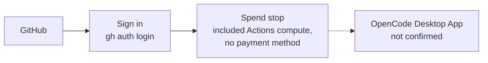

# GitHub

GitHub gives free CI on Actions and a hosted MCP server. It serves no open-weight models of its own, so OpenCode wiring to it is not confirmed.



| Account | Free tier | Login or key | OpenCode | Guard |
| --- | --- | --- | --- | --- |
| Anyone with an email, on the GitHub Free plan. | Standard runners are free in public repositories. Free plans include $12 USD of compute a month ([Actions billing](https://docs.github.com/en/billing/concepts/product-billing/github-actions), read 2026-11-24). | `gh auth login --web` (browser OAuth). Automation uses a GitHub App. | Not confirmed. No OpenCode step for GitHub was read for this guide. | With no payment method, Actions stop when the included compute is spent ([Actions billing](https://docs.github.com/en/billing/concepts/product-billing/github-actions), read 2026-11-24). [More](detail/github.md#guard). See [Git Crafter compute rules](https://github.com/SoulCraft-Org/git-crafter/blob/main/rules/compute.md). |

## Wiring

| Host | Plugs in as | Source |
| --- | --- | --- |
| OpenCode Desktop App | Not confirmed. No GitHub or OpenCode page was read for a route to GitHub's MCP server. | None read |

<details>
<summary>Commands</summary>

```bash
gh auth login --web --git-protocol https
gh auth status
opencode auth login
```

</details>

Guard, set up and App manifest: [GitHub detail](detail/github.md). Traps and sources: [GitHub traps and sources](detail/github-traps.md).
