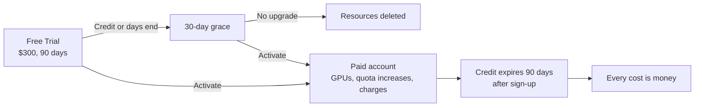

# Google Cloud

Google Cloud gives a Claude Code or OpenCode user a trial credit for CPUs and storage, which Google's Free Trial page ([Free cloud features](https://docs.cloud.google.com/free/docs/free-cloud-features), read 2026-11-23) sets at $300. The credit has exclusions, and an upgrade can turn covered usage into a bill.

| Account | Free tier | Login or key | Claude connector | OpenCode | Guard |
| --- | --- | --- | --- | --- | --- |
| A Google account. Sign-up needs a credit card or other payment method valid for the trial ([Free cloud features](https://docs.cloud.google.com/free/docs/free-cloud-features), read 2026-11-23). | Free Trial: $300 Welcome credit valid for 90 days, and no billing unless you upgrade ([Free cloud features](https://docs.cloud.google.com/free/docs/free-cloud-features), read 2026-11-23). | `gcloud auth login`, a browser sign-in. Keep service account keys out of CI. | None the credit pays for. It cannot pay for partner models offered as a managed API ([Free cloud features](https://docs.cloud.google.com/free/docs/free-cloud-features), read 2026-11-23). | `google-vertex` exists in [models.dev](https://models.dev/api.json) (read 2026-11-23). The credit cannot pay for it from 2026-11-16. | A Free Trial account is not billed. After 90 days or when the credit ends, it has a 30-day grace period, then Google deletes its resources. Upgrading removes that stop. |

## What the credit cannot pay for

Google's page says the credit cannot pay for the Gemini platform (Vertex AI) if you sign up or upgrade on or after 2026-11-16. It also cannot pay for the Gemini API in AI Studio, or for partner models offered as a managed API ([Free cloud features](https://docs.cloud.google.com/free/docs/free-cloud-features), read 2026-11-23). Run those on a Free Tier, a prepay plan, or a different vendor in this repo.

## Set up

1. Sign up for the Free Trial in the Cloud console. Write down the sign-up date: the credit ends 90 days after it ([Free cloud features](https://docs.cloud.google.com/free/docs/free-cloud-features), read 2026-11-23).
2. Stay on the trial for CPU work. While it lasts, you cannot add GPUs, use Marketplace, or request a quota increase ([Free cloud features](https://docs.cloud.google.com/free/docs/free-cloud-features), read 2026-11-23).
3. Upgrade only when you need a GPU or a quota increase. On the Welcome page choose **Activate**. Google then bills usage that the credit and the Free Tier do not cover ([Free cloud features](https://docs.cloud.google.com/free/docs/free-cloud-features), read 2026-11-23).
4. On a paid account, set a budget, then a kill switch, then a quota. Detail and limits: [Google Cloud spend caps](detail/google-cloud.md#spend-caps).

## The lesson

On a paid account, a net-cost budget plus a kill switch is the right pair, because the budget counts what you really pay. An upgrade is the moment usage the credit covered can become real charges.

Traps and sources: [Google Cloud traps and sources](detail/google-cloud.md).
