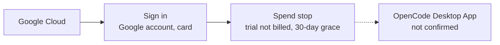

# Google Cloud

Google Cloud gives a Free Trial credit for CPUs and storage, which Google's Free Trial page ([Free cloud features](https://docs.cloud.google.com/free/docs/free-cloud-features), read 2026-11-24) sets at $300. It does not pay for Gemini models, so it does not wire to the OpenCode Desktop App as inference.



| Account | Free tier | Login or key | OpenCode | Guard |
| --- | --- | --- | --- | --- |
| A Google account. Sign-up needs a card or other payment method valid for the trial ([Free cloud features](https://docs.cloud.google.com/free/docs/free-cloud-features), read 2026-11-24). | Google says a $300 Welcome credit over 90 days. No GPUs while the trial is unbilled ([Free cloud features](https://docs.cloud.google.com/free/docs/free-cloud-features), read 2026-11-24). | `gcloud auth login`, a browser sign-in. | `google-vertex` is in the catalog. The credit cannot pay for Vertex AI from 2026-11-16 ([Free cloud features](https://docs.cloud.google.com/free/docs/free-cloud-features), read 2026-11-24). | Unbilled trial; after it ends, 30 days of grace ([Free cloud features](https://docs.cloud.google.com/free/docs/free-cloud-features), read 2026-11-24), then deletion. Upgrading removes the stop. [Guard detail](detail/google-cloud.md#guard). See [Git Crafter compute rules](https://github.com/SoulCraft-Org/git-crafter/blob/main/rules/compute.md). |

## Wiring

| Host | Plugs in as | Source, read 2026-11-24 |
| --- | --- | --- |
| OpenCode Desktop App | Not confirmed. The catalog lists `google-vertex` with key variables `GOOGLE_VERTEX_PROJECT`, `GOOGLE_VERTEX_LOCATION` and `GOOGLE_APPLICATION_CREDENTIALS`. The credit does not pay for Vertex AI from 2026-11-16. | [models.dev](https://models.dev/api.json), [Free cloud features](https://docs.cloud.google.com/free/docs/free-cloud-features) |

## What the credit cannot pay for

For a sign-up or upgrade on or after 2026-11-16, it cannot pay for the Gemini platform (Vertex AI). It cannot pay for the Gemini API in AI Studio, or for a generative AI partner model offered as a managed API. Google points to the Free tier or a prepay plan instead ([Free cloud features](https://docs.cloud.google.com/free/docs/free-cloud-features), read 2026-11-24).

<details>
<summary>Commands</summary>

```bash
gcloud auth login
```

</details>

Guard and set up: [Google Cloud detail](detail/google-cloud.md). Traps and sources: [Google Cloud traps and sources](detail/google-cloud-traps.md).
