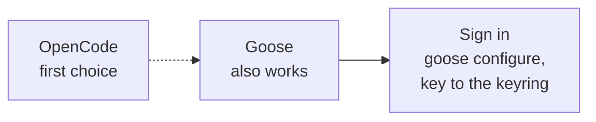

# Goose

Also works with OpenCode: Goose is a free, open-source agent (Apache-2.0) with a desktop app and a CLI. It sits under the Agentic AI Foundation at the Linux Foundation ([README](https://github.com/aaif-goose/goose), read 2026-11-24). OpenCode is the first choice. This page is a short secondary note, and it covers open-weight models on your own keys only.



| Account | Free tier | Login or key | OpenCode | Guard |
| --- | --- | --- | --- | --- |
| None for Goose, which is Apache-2.0 ([README](https://github.com/aaif-goose/goose), read 2026-11-24). Each model provider has its own account. | Goose costs nothing. Models bill through the provider you pick, so choose a free tier from these guides. | `goose configure` stores the key in the system keyring, a Keychain item named `goose` on macOS ([config/base.rs](https://github.com/aaif-goose/goose/blob/main/crates/goose/src/config/base.rs), read 2026-11-20). | Not confirmed. Both run as ACP agents, and OpenCode is the one these guides wire ([OpenCode ACP](https://opencode.ai/docs/cli/acp), read 2026-11-24). | No spend stop of its own. The default tool mode `auto` edits and deletes files without approval ([Permissions](https://goose-docs.ai/docs/guides/managing-tools/goose-permissions), read 2026-11-24). See [Git Crafter compute rules](https://github.com/SoulCraft-Org/git-crafter/blob/main/rules/compute.md). |

## Wiring

| Host | Plugs in as | Source |
| --- | --- | --- |
| OpenCode Desktop App | Not confirmed. Goose's pages name no OpenCode link. Both run as ACP agents. | [Goose README](https://github.com/aaif-goose/goose), read 2026-11-24; [OpenCode ACP](https://opencode.ai/docs/cli/acp), read 2026-11-24 |

<details>
<summary>Commands</summary>

```bash
brew install block-goose-cli
brew install --cask block-goose
goose configure
```

</details>

Set up: [Goose detail](detail/goose.md). Traps and sources: [Goose traps and sources](detail/goose-traps.md).
