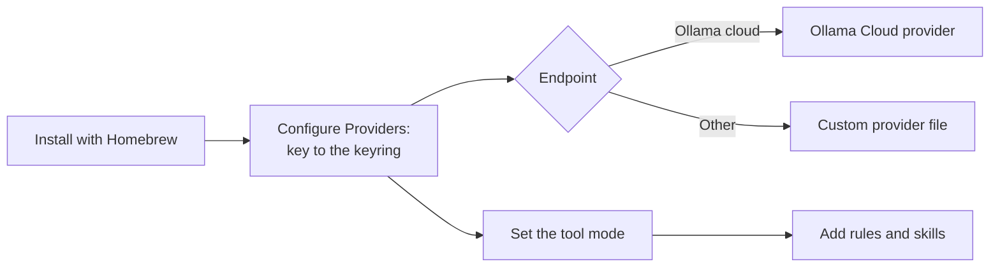

# Goose

Goose is a free, open-source coding agent with a desktop app and a CLI. It runs open-weight models from many providers, and runs inside Zed over the Agent Client Protocol (ACP). It is part of the Agentic AI Foundation at the Linux Foundation ([README](https://github.com/aaif-goose/goose), read 2026-11-20).

| Account | Free tier | Login or key | Claude connector | OpenCode | Guard |
| --- | --- | --- | --- | --- | --- |
| None. Goose is Apache-2.0 software ([aaif-goose/goose](https://github.com/aaif-goose/goose), read 2026-11-20); each model provider has its own account. | Goose itself costs nothing. Models bill through the provider you pick, so use a free tier from these guides. | `goose configure` stores a provider key in the system keyring: on macOS, the Keychain item with service `goose` and account `secrets` ([config/base.rs](https://github.com/aaif-goose/goose/blob/main/crates/goose/src/config/base.rs), read 2026-11-20). A provider's environment variable wins over stored secrets ([Configuration files](https://goose-docs.ai/docs/guides/config-files), read 2026-11-20). | The `claude-acp` provider runs Claude Code through ACP, with an active Claude Code subscription ([Providers](https://goose-docs.ai/docs/getting-started/providers), read 2026-11-20). | None: Goose and OpenCode are peer agents. Both run in Zed through `goose acp` and `opencode acp` ([Zed](zed.md)). | Goose has no spend stop of its own; the provider's guard applies. Its default tool mode, `auto`, edits and deletes files without approval ([Permissions](https://goose-docs.ai/docs/guides/managing-tools/goose-permissions), read 2026-11-20). Set `approve` or `smart_approve`. See [Git Crafter compute rules](https://github.com/SoulCraft-Org/git-crafter/blob/main/rules/compute.md). |



## Set up

1. Install the CLI with Homebrew, which also updates it ([Install goose](https://goose-docs.ai/docs/getting-started/installation), read 2026-11-20). The desktop app is the `block-goose` cask.

```bash
brew install block-goose-cli
```

2. Pick a provider and model. Choose **Configure Providers**, then enter the key at the prompt so it goes to the keyring.

```bash
goose configure
```

3. For Ollama's cloud, pick the **Ollama Cloud** provider, which reads `OLLAMA_CLOUD_API_KEY`. Use cloud models only; the plain **Ollama** provider is for a local server ([Providers](https://goose-docs.ai/docs/getting-started/providers), read 2026-11-20). See [Ollama](ollama.md) for its credits.

4. For any other OpenAI-compatible endpoint, add a custom provider file in `~/.config/goose/custom_providers/`. Its `api_key_env` names the variable that holds the key, and the Desktop app can store the key in the keyring instead ([Providers](https://goose-docs.ai/docs/getting-started/providers), read 2026-11-20).

```json
{
  "name": "<provider_id>",
  "engine": "openai",
  "display_name": "<Provider>",
  "api_key_env": "<CONSUMER>_<VENDOR>_API_KEY",
  "base_url": "https://<base-url>/v1/chat/completions",
  "models": [{ "name": "<model>", "context_limit": 128000 }],
  "requires_auth": true
}
```

5. Set the tool mode in `~/.config/goose/config.yaml`, or per session with `/mode smart_approve` ([Configuration files](https://goose-docs.ai/docs/guides/config-files), read 2026-11-20).

```yaml
GOOSE_MODE: smart_approve
```

6. Give Goose project rules and skills. It reads `AGENTS.md`, then `.goosehints`, in each folder ([Project instructions](https://goose-docs.ai/docs/guides/context-engineering/using-goosehints), read 2026-11-20). It loads skills from `~/.agents/skills/`, and from `<project>/.agents/skills/` and `<project>/.claude/skills/` ([Skills](https://goose-docs.ai/docs/guides/context-engineering/using-skills), read 2026-11-20).

Traps and sources: [Goose traps and sources](detail/goose.md).
