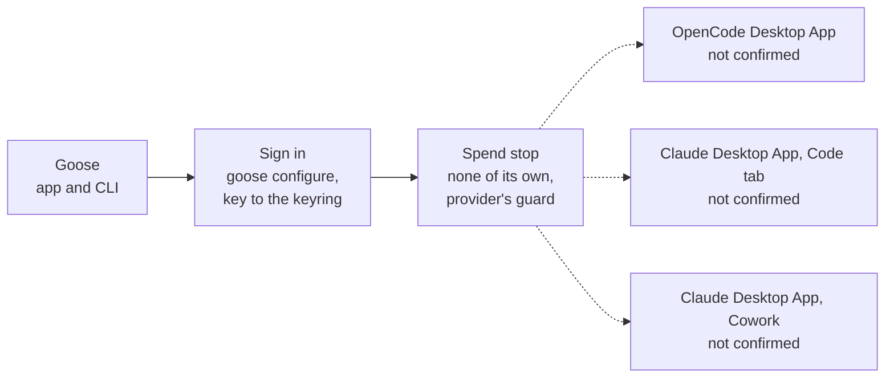

# Goose

Goose is a free, open-source agent with a desktop app and a CLI. It runs open-weight models from many providers and runs inside Zed over the Agent Client Protocol (ACP). It is part of the Agentic AI Foundation at the Linux Foundation ([README](https://github.com/aaif-goose/goose), read 2026-11-24).



| Account | Free tier | Login or key | Claude connector | OpenCode | Guard |
| --- | --- | --- | --- | --- | --- |
| None for Goose, which is Apache-2.0 ([README](https://github.com/aaif-goose/goose), read 2026-11-24). Each model provider has its own account. | Goose costs nothing. Models bill through the provider you pick, so choose a free tier from these guides. | `goose configure` stores the key in the system keyring, a Keychain item named `goose` on macOS ([config/base.rs](https://github.com/aaif-goose/goose/blob/main/crates/goose/src/config/base.rs), read 2026-11-20). | None. Goose's `claude-acp` provider needs a Claude subscription; it is not a Desktop connector ([Providers](https://goose-docs.ai/docs/getting-started/providers), read 2026-11-24). | Not confirmed. Both agents run in Zed through `goose acp` and `opencode acp` ([Zed](zed.md)). | No spend stop of its own. The default tool mode `auto` edits and deletes files without approval ([Permissions](https://goose-docs.ai/docs/guides/managing-tools/goose-permissions), read 2026-11-24). See [Git Crafter compute rules](https://github.com/SoulCraft-Org/git-crafter/blob/main/rules/compute.md). |

## Wiring

| Host | Plugs in as | Source |
| --- | --- | --- |
| OpenCode Desktop App | Not confirmed. Goose's pages name no OpenCode link. Both run as ACP agents, and Zed lists OpenCode in its ACP Registry. | [Goose README](https://github.com/aaif-goose/goose), read 2026-11-24; [OpenCode ACP](https://opencode.ai/docs/cli/acp), read 2026-11-24 |
| Claude Desktop App, Code tab | Not confirmed. Goose's pages name no Claude Desktop step. Goose passes its extensions to ACP agents as MCP servers. | [Providers](https://goose-docs.ai/docs/getting-started/providers), read 2026-11-24 |
| Claude Desktop App, Cowork | Not confirmed. Neither Goose's pages nor the Desktop docs name a Goose step for Cowork. | [Providers](https://goose-docs.ai/docs/getting-started/providers), read 2026-11-24; [Desktop docs](https://code.claude.com/docs/en/desktop), read 2026-11-24 |

<details>
<summary>Commands</summary>

```bash
brew install block-goose-cli
brew install --cask block-goose
goose configure
```

</details>

Set up: [Goose detail](detail/goose.md). Traps and sources: [Goose traps and sources](detail/goose-traps.md).
