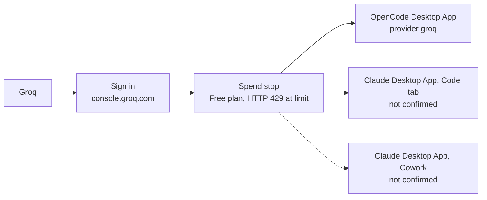

# Groq

Groq gives the OpenCode Desktop App fast hosted open-weight models, such as `qwen/qwen3.8-27b`, on a free plan.



| Account | Free tier | Login or key | Claude connector | OpenCode | Guard |
| --- | --- | --- | --- | --- | --- |
| Console sign-in; a payment method is asked for on upgrade to Developer ([Billing FAQs](https://console.groq.com/docs/billing-faqs), read 2026-11-24). | 30 requests and 8K tokens a minute on `openai/gpt-oss-120b`, `gpt-oss-20b` and `qwen/qwen3.8-27b` ([Rate Limits](https://console.groq.com/docs/rate-limits), read 2026-11-24). [Detail](detail/groq.md#free-tier). | `GROQ_API_KEY`, from a key made in the console. | None hosted. A local [Groq MCP Server](https://github.com/groq/groq-mcp-server) is listed ([Examples](https://console.groq.com/docs/examples), read 2026-11-24). | `groq` ([models.dev](https://models.dev), read 2026-11-12). | Past a limit, Groq returns 429 ([Rate Limits](https://console.groq.com/docs/rate-limits), read 2026-11-24). Upgrading removes the stop. [Detail](detail/groq.md#guard). See [Git Crafter compute rules](https://github.com/SoulCraft-Org/git-crafter/blob/main/rules/compute.md). |

## Wiring

| Host | Plugs in as | Source |
| --- | --- | --- |
| OpenCode Desktop App | Connect provider Groq with a console key. OpenCode 2 stores it as an account in its database. | [OpenCode + Groq](https://console.groq.com/docs/coding-with-groq/opencode) (read 2026-11-12), [CLI providers](https://opencode.ai/docs/cli/providers) (read 2026-11-20) |
| Claude Desktop App, Code tab | Not confirmed. Groq's pages name no Claude Desktop step. | [Examples](https://console.groq.com/docs/examples), read 2026-11-24 |
| Claude Desktop App, Cowork | Not confirmed. The listed MCP server is local, and no page names Cowork. | [Examples](https://console.groq.com/docs/examples), read 2026-11-24 |

<details>
<summary>Commands</summary>

```bash
opencode auth login groq --method key
```

Enter the key at the hidden prompt, then pick `groq/qwen/qwen3.8-27b` with `/models`.

</details>

Free tier, guard, traps and sources: [Groq detail](detail/groq.md).
