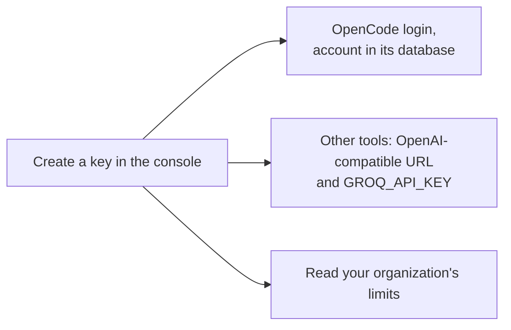

# Groq

Groq gives a Claude Code or OpenCode user fast hosted open-weight models, such as `qwen/qwen3.8-27b`, on a free plan.

| Account | Free tier | Login or key | Claude connector | OpenCode | Guard |
| --- | --- | --- | --- | --- | --- |
| Anyone with a GroqCloud console sign-in; a payment method is asked for only on upgrade to Developer ([Billing FAQs](https://console.groq.com/docs/billing-faqs), read 2026-11-12). | Free plan, per model: `openai/gpt-oss-120b`, `openai/gpt-oss-20b` and `qwen/qwen3.8-27b` each get 30 requests per minute, 1K per day, 8K tokens per minute and 200K tokens per day ([Rate Limits](https://console.groq.com/docs/rate-limits), read 2026-11-12). | `GROQ_API_KEY`, from a key made in the console. | None hosted. Groq's Examples page lists a local [Groq MCP Server](https://github.com/groq/groq-mcp-server) ([Examples](https://console.groq.com/docs/examples), read 2026-11-12). | `groq` ([models.dev](https://models.dev), read 2026-11-12), through `/connect`. | The Free plan stops with `429 Too Many Requests` at a limit ([Rate Limits](https://console.groq.com/docs/rate-limits), read 2026-11-12). Adding a payment method to upgrade to Developer removes it. See [Git Crafter compute rules](https://github.com/SoulCraft-Org/git-crafter/blob/main/rules/compute.md). |



## Set up

1. Sign in at [console.groq.com](https://console.groq.com) and create an API key there. Keep the key in the console's copy step and your secret store; never paste it into a chat or a command.

2. Connect Groq in OpenCode. OpenCode 2 saves the key as an account in its SQLite database, not in `auth.json` ([CLI providers](https://opencode.ai/docs/cli/providers), read 2026-11-20). See [OpenCode 2](README.md#opencode-2).

```bash
opencode auth login groq --method key
```

Enter the key at the hidden prompt, then run `/models` inside OpenCode and pick `groq/qwen/qwen3.8-27b`.

3. Any other OpenAI-compatible tool uses base URL `https://api.groq.com/openai/v1` with `GROQ_API_KEY` set in its environment ([OpenAI Compatibility](https://console.groq.com/docs/openai), read 2026-11-12).

4. Read your own organization's limits on the console's limits page before a long run. The rate-limit page points there for exact values.

Traps and sources: [Groq traps and sources](detail/groq.md).
