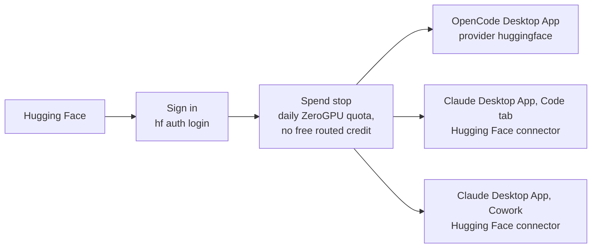

# Hugging Face

Hugging Face gives the OpenCode Desktop App and the Claude Desktop App the Hub's open-weight models. It adds a free daily ZeroGPU allowance inside Gradio Spaces, routed Inference Providers, and an official MCP server.



| Account | Free tier | Login or key | Claude connector | OpenCode | Guard |
| --- | --- | --- | --- | --- | --- |
| Anyone with an email. Hosting ZeroGPU Spaces needs a verified email and an account older than 30 days ([ZeroGPU](https://huggingface.co/docs/hub/spaces-zerogpu), read 2026-11-12). | ZeroGPU: 5 minutes a day free, 40 on PRO ([ZeroGPU](https://huggingface.co/docs/hub/spaces-zerogpu), read 2026-11-12). PRO costs $9 a month ([Pricing](https://huggingface.co/pricing), read 2026-11-12). [More](detail/hugging-face.md#free-tier). | `hf auth login` (browser). Tools that need a token read `HF_TOKEN`. | `https://huggingface.co/mcp` ([Hugging Face MCP Server](https://huggingface.co/docs/hub/agents-mcp), read 2026-11-24). | `huggingface`, reads `HF_TOKEN`, base URL `https://router.huggingface.co/v1` ([models.dev](https://models.dev), read 2026-11-24). | A free account has no routed-call credit: buy credits first ([Pricing and Billing](https://huggingface.co/docs/inference-providers/pricing), read 2026-11-12). [More](detail/hugging-face.md#guard). See [Git Crafter compute rules](https://github.com/SoulCraft-Org/git-crafter/blob/main/rules/compute.md). |

## Wiring

| Host | Plugs in as | Source, read 2026-11-24 |
| --- | --- | --- |
| OpenCode Desktop App | Connect provider Hugging Face with a fine-grained token that has the Inference Providers permission. Calls fail on a free account until it holds purchased credits. | [HF: OpenCode](https://huggingface.co/docs/inference-providers/integrations/opencode), [OpenCode providers](https://opencode.ai/docs/providers) |
| Claude Desktop App, Code tab | Tools: add "Hugging Face" from the connector gallery. Models: not confirmed. Hugging Face names only the Claude Code CLI. | [hf-mcp-server](https://github.com/huggingface/hf-mcp-server), [HF: Claude Code](https://huggingface.co/docs/inference-providers/integrations/claude-code), [Desktop docs](https://code.claude.com/docs/en/desktop) |
| Claude Desktop App, Cowork | The same connector. Cowork takes connectors from your claude.ai account. Hugging Face names no Cowork step. | [Desktop docs](https://code.claude.com/docs/en/desktop), [HF MCP Server](https://huggingface.co/docs/hub/agents-mcp) |

<details>
<summary>Commands</summary>

```bash
uvx hf auth login
uvx hf auth whoami
opencode auth login huggingface --method key
```

</details>

Free tier, guard and set up: [Hugging Face detail](detail/hugging-face.md). Traps and sources: [Hugging Face traps and sources](detail/hugging-face-traps.md).
