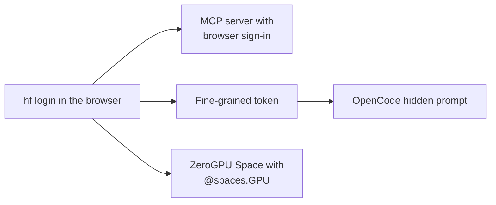

# Hugging Face

Hugging Face gives a Claude Code or OpenCode user the Hub's open-weight models, a free daily ZeroGPU allowance inside Gradio Spaces, routed Inference Providers, and an official MCP server.

| Account | Free tier | Login or key | Claude connector | OpenCode | Guard |
| --- | --- | --- | --- | --- | --- |
| Anyone with an email address. Hosting ZeroGPU Spaces needs a verified email and an account older than 30 days ([ZeroGPU](https://huggingface.co/docs/hub/spaces-zerogpu), read 2026-11-12). | ZeroGPU: 5 minutes a day on a free account, 2 minutes signed out, 40 minutes on PRO ([ZeroGPU](https://huggingface.co/docs/hub/spaces-zerogpu), read 2026-11-12). A free account hosts up to 2 ZeroGPU Spaces ([ZeroGPU](https://huggingface.co/docs/hub/spaces-zerogpu), read 2026-11-12). CPU Basic: 2 vCPU, 16 GB, free ([Spaces overview](https://huggingface.co/docs/hub/spaces-overview), read 2026-11-12). Inference Providers: no monthly credit for free users, $2.00 for PRO ([Pricing and Billing](https://huggingface.co/docs/inference-providers/pricing), read 2026-11-12). PRO costs $9 a month ([Pricing](https://huggingface.co/pricing), read 2026-11-12). | `hf auth login` (browser). Tools that need a token read `HF_TOKEN`. | `https://huggingface.co/mcp` ([Hugging Face MCP Server](https://huggingface.co/docs/hub/agents-mcp), read 2026-11-12). | `huggingface`, reads `HF_TOKEN`, base URL `https://router.huggingface.co/v1` ([models.dev](https://models.dev), read 2026-11-12). | A free account has no Inference Providers credit, so routed calls need a credit purchase first ([Pricing and Billing](https://huggingface.co/docs/inference-providers/pricing), read 2026-11-12). Free ZeroGPU stops at the daily quota. Buying credits removes the stop: on PRO, ZeroGPU past quota bills "$1 per 10 minutes" automatically ([ZeroGPU](https://huggingface.co/docs/hub/spaces-zerogpu), read 2026-11-12). See [Git Crafter compute rules](https://github.com/SoulCraft-Org/git-crafter/blob/main/rules/compute.md). |



## Set up

1. Log the CLI in through the browser. `uvx` runs the latest `hf` with no install; `brew install hf` installs it ([CLI guide](https://huggingface.co/docs/huggingface_hub/guides/cli), read 2026-11-12).

```bash
uvx hf auth login
uvx hf auth whoami
```

The login saves a token under `~/.cache/huggingface/`. Other Hugging Face tools on the machine read it from there.

2. Add the Hugging Face MCP server to Claude Code with browser sign-in. The `?login` form comes from Hugging Face's own server repo ([hf-mcp-server](https://github.com/huggingface/hf-mcp-server), read 2026-11-12).

```bash
claude mcp add --transport http hf-mcp-server "https://huggingface.co/mcp?login"
claude mcp login hf-mcp-server
```

Pick extra tools and Spaces at [MCP settings](https://huggingface.co/settings/mcp). That page also prints a snippet for each client.

3. Connect OpenCode to Inference Providers. Make a fine-grained token at [Access Tokens](https://huggingface.co/settings/tokens), then paste it at OpenCode's hidden prompt ([OpenCode 2](README.md#opencode-2)).

```bash
opencode auth login huggingface --method key
```

Calls fail on a free account until it holds purchased credits.

4. Host a ZeroGPU Space. Pick the Gradio SDK and ZeroGPU hardware, then decorate each GPU function with `@spaces.GPU` ([ZeroGPU](https://huggingface.co/docs/hub/spaces-zerogpu), read 2026-11-12). The default `large` size is half an RTX Pro 6000 Blackwell, 48 GB ([ZeroGPU](https://huggingface.co/docs/hub/spaces-zerogpu), read 2026-11-12).

Traps and sources: [Hugging Face traps and sources](detail/hugging-face.md).
