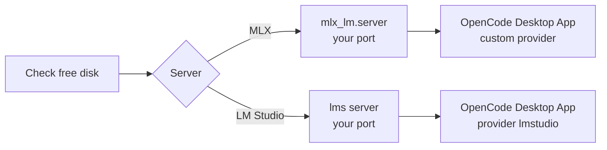

# Local models

A Mac with Apple silicon can serve open-weight models through MLX or LM Studio, with no account and no bill. The OpenCode Desktop App reaches them.



| Tool | Serves | Port | OpenCode | Guard |
| --- | --- | --- | --- | --- |
| MLX `mlx_lm.server` | `/v1/chat/completions`, `/v1/completions` and `/v1/models` ([server.py](https://github.com/ml-explore/mlx-lm/blob/main/mlx_lm/server.py), read 2026-11-24) | Default 8080. Pass `--port 3101` | Custom provider, base URL `http://127.0.0.1:3101/v1` | Local only. MLX calls it not for production, with basic security checks ([SERVER.md](https://github.com/ml-explore/mlx-lm/blob/main/mlx_lm/SERVER.md), read 2026-11-24). No `--trust-remote-code` on a shared folder |
| LM Studio `lms` | OpenAI `/v1` and Anthropic `/v1/messages` ([Anthropic compatibility](https://lmstudio.ai/docs/developer/anthropic-compat), read 2026-11-24) | Reuses the last port. Pass `--port 3102` | Built-in `lmstudio`, base URL `http://127.0.0.1:3102/v1` | `--bind` defaults to `127.0.0.1` ([lms server start](https://lmstudio.ai/docs/cli/server-start), read 2026-11-24). Never bind 0.0.0.0 without authentication |

Both run on your own hardware, so no spend stop applies. Git Crafter's money and compute split still does: [Git Crafter compute rules](https://github.com/SoulCraft-Org/git-crafter/blob/main/rules/compute.md).

## Wiring

| Host | Plugs in as | Source, read 2026-11-24 |
| --- | --- | --- |
| OpenCode Desktop App | LM Studio: provider `lmstudio`, with `settings.baseURL` set only when it is not at the default. MLX: a custom OpenAI-compatible provider with the model listed by hand. | [OpenCode providers](https://opencode.ai/docs/providers), [models.dev](https://models.dev/api.json) |

<details>
<summary>Commands</summary>

```bash
df -h ~
pip install mlx-lm
mlx_lm.server --model mlx-community/<model> --port 3101
curl -s http://127.0.0.1:3101/v1/models
lms get <model> --mlx
lms load <model>
lms server start --port 3102
lms status
```

</details>

Set up, traps and sources: [Local models detail](detail/local-models.md), [Local models traps and sources](detail/local-models-traps.md).
