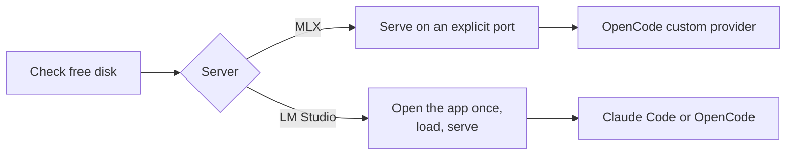

# Local models

A Mac with Apple silicon can serve open-weight models to Claude Code or OpenCode through MLX or LM Studio, with no account and no bill.

| Tool | Serves | Port | Claude Code | OpenCode | Guard |
| --- | --- | --- | --- | --- | --- |
| MLX `mlx_lm.server` | OpenAI-style `/v1/chat/completions`, `/v1/completions` and `/v1/models` ([server.py](https://github.com/ml-explore/mlx-lm/blob/main/mlx_lm/server.py), read 2026-11-12) | Default 8080 on 127.0.0.1. Pass `--port 3101` | None directly: the server has no Anthropic Messages route | Custom provider, package `@opencode/ai/providers/openai-compatible`, base URL `http://127.0.0.1:3101/v1` | Binds 127.0.0.1 by default. MLX calls it unfit for production, with basic security checks only ([SERVER.md](https://github.com/ml-explore/mlx-lm/blob/main/mlx_lm/SERVER.md), read 2026-11-12). Never pass `--trust-remote-code` for a shared folder |
| LM Studio `lms` | OpenAI-compatible `/v1` and Anthropic-compatible `/v1/messages` ([Anthropic compatibility](https://lmstudio.ai/docs/developer/anthropic-compat), read 2026-11-12) | Default 1234. Pass `--port 3102` | `ANTHROPIC_BASE_URL=http://127.0.0.1:3102`, no `/v1` ([LM Studio for Claude Code](https://lmstudio.ai/docs/integrations/claude-code), read 2026-11-12) | Built-in provider `lmstudio`; set `settings.baseURL` to `http://127.0.0.1:3102/v1` | `--bind` defaults to localhost ([lms server start](https://lmstudio.ai/docs/cli/server-start), read 2026-11-12). Never bind 0.0.0.0 without **Require Authentication** |

Both run on your own hardware, so no spend stop applies. Git Crafter's money and compute split still does: [Git Crafter compute rules](https://github.com/SoulCraft-Org/git-crafter/blob/main/rules/compute.md).



## Set up

1. Check free disk before any download. A model is several GB, and both tools download on demand.

   ```bash
   df -h ~
   ```

2. MLX: install and serve on an explicit port ([mlx-lm README](https://github.com/ml-explore/mlx-lm), read 2026-11-12). The server downloads a Hugging Face repo it has not cached.

   ```bash
   pip install mlx-lm
   mlx_lm.server --model mlx-community/<model> --port 3101
   curl -s http://127.0.0.1:3101/v1/models
   ```

3. OpenCode with MLX: add a custom provider to `opencode.jsonc` and list the model by hand ([OpenCode providers](https://opencode.ai/docs/providers), read 2026-11-12).

   ```json
   {
     "$schema": "https://opencode.ai/config.json",
     "providers": {
       "mlx": {
         "name": "MLX",
         "package": "@opencode/ai/providers/openai-compatible",
         "settings": { "baseURL": "http://127.0.0.1:3101/v1" },
         "models": { "mlx-community/<model>": { "name": "<model>" } }
       }
     }
   }
   ```

4. LM Studio: open the app once so `lms` works ([lms CLI](https://lmstudio.ai/docs/cli), read 2026-11-12). Then download, load and serve.

   ```bash
   lms get <model> --mlx
   lms load <model>
   lms server start --port 3102
   lms status
   ```

5. Claude Code with LM Studio. With authentication off, the token is the placeholder string from LM Studio's guide. With **Require Authentication** on, set `ANTHROPIC_AUTH_TOKEN` from your password manager instead.

   ```bash
   ANTHROPIC_BASE_URL=http://127.0.0.1:3102 ANTHROPIC_AUTH_TOKEN=lmstudio claude --model <model>
   ```

6. OpenCode with LM Studio: set `providers.lmstudio.settings.baseURL` to `http://127.0.0.1:3102/v1`, then pick the model in `/models`.

Traps and sources: [Local models traps and sources](detail/local-models.md).
